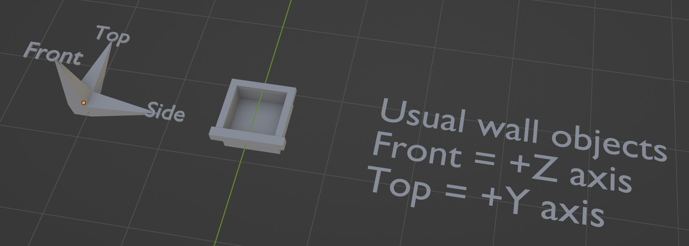
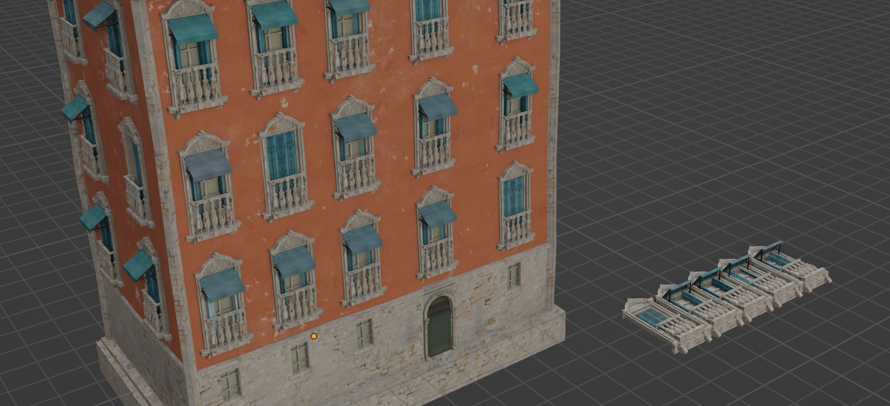
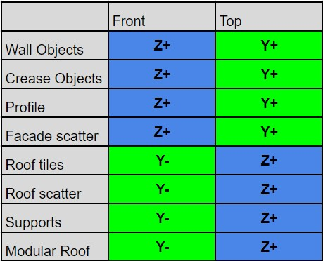
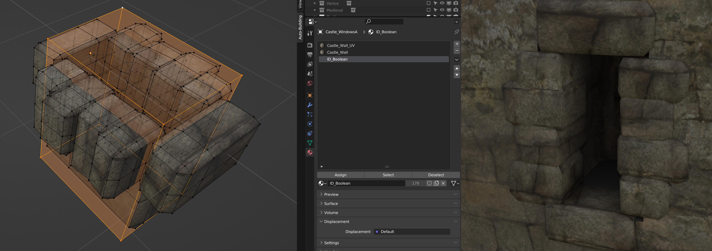

Building parts
==============

The parts used by the system must be oriented in a specific way to work properly.

For most parts (windows, doors, etc.), the top of the object should point toward the **positive Y axis**, and the front toward the **positive Z axis**.
Just like Blender's Asset Browser orientation convention, the Z axis is used perpendicular to the surface the object lands on.

Every part must be placed in its own collection. If a collection contains several objects, the system picks between them randomly.

Some objects, such as roof or support parts, use a slightly different orientation.

If you are unsure, a text label is placed next to the Example Objects, and an Orientation Checker object is included so you can test your parts.

Here is the full list of directions:

.. _part-booleans:

Booleans
--------

If you want an object to cut a hole in the face it sits on (a window, for instance), model an extra shape (like a box) together with your object and assign the **ID_Boolean** material to it.
This shape is used to boolean a hole into the wall and is never rendered.
