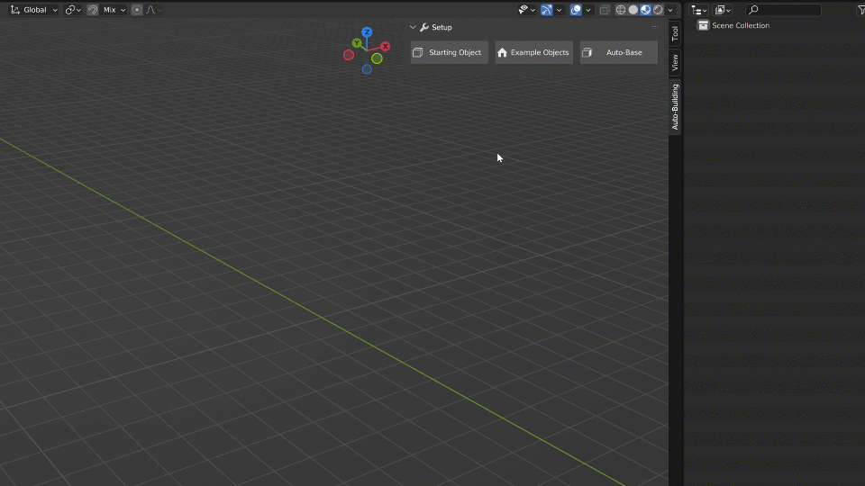

Start
=====

Starting Object
---------------

Creating your own building style from scratch is a very easy process!
With the addon enabled, simply click either **Starting Object** or **Example Object** to begin.

The **Starting Object** creates a simple cube, adds the Auto-Building modifier to it, and sets up all the necessary materials.

The **Example Object** is a bit more complete: it comes already set up with simple geometry and collections, giving you a quick start for the modeling process.

.. image:: images/ImportExample.gif

You can also start from a preset: grab any building from the Asset Browser, then either modify it to your taste, or manually transfer its Geometry Nodes modifier and ID materials onto the object you want to work on.

Assign Boolean Faces
--------------------

When you model your own parts (windows, doors…), the faces that should cut a hole in the wall need the ``ID_Boolean`` material.
Select the object (one **without** the Auto-Building modifier), go to Edit Mode, select the faces and click **Assign Boolean Faces** in the **Setup** panel. The material slot is added automatically if needed.
