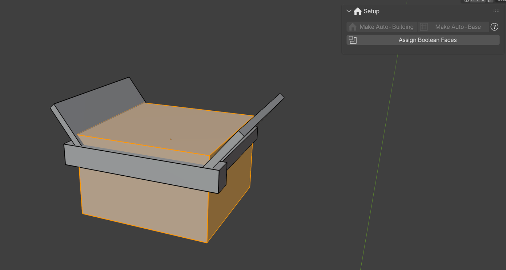

Setup Panel
===========

The **Setup** panel sits at the top of the Auto-Building tab. It creates new buildings and holds the everyday switches.

.. image:: images/panel_setup.png
   :alt: Setup panel
   :width: 420px

Creating a building
-------------------

``Make Auto-Building``
  Adds the Auto-Building modifier, all the ``ID_`` material slots and the needed vertex groups to the **selected meshes**, and puts their origin at the bottom. With nothing selected, it creates a cube ready to edit.

``Make Auto-Base``
  Same for :doc:`autobase`: with nothing selected, it creates a single-face plane that grows into a whole building base.

``?``
  Opens this documentation.

.. tip::
   Any mesh can become a building: select your own blockout and click **Make Auto-Building**. You can also start from a preset of the Asset Browser (see :doc:`installation`).

Everyday switches
-----------------

These appear once a building is selected.

``Fast mode``
  Turns off the heaviest features for a fast viewport while you model. It turns red when on, so you don't forget it before rendering.

``Apply Modifier``
  Turns the building into real objects **without losing the instancing**: the shell becomes a mesh, and every placed piece becomes a child object sharing its mesh with the identical pieces. A hidden backup of the original is kept in the ``AB_APPLY_BACKUP`` collection. See :doc:`baking`.

The number next to it is the version of the Auto-Building node tree used by this building.

Assign Boolean Faces
--------------------

For your own parts (windows, doors…): the faces that should **cut a hole** in the wall need the ``ID_Boolean`` material.

Select the part (an object **without** the Auto-Building modifier), enter **Edit Mode** in face select mode, select the faces and click **Assign Boolean Faces**. The material slot is added if needed.

See :ref:`part-booleans` for how to model the cutting shape.
