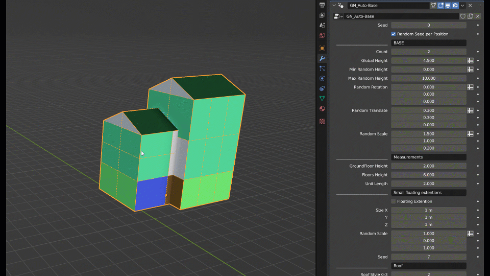
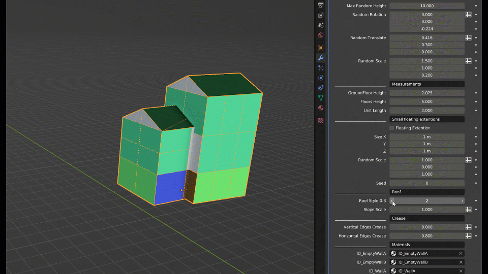

Auto-Base
=========

.. image:: images/AutoBaseVariations.gif

Auto-Base is a companion Geometry Nodes tool for Auto-Building. It generates a base mesh for your buildings — it won't beat manual modeling, but it's great for quick variations or as a starting point.

Simply add the **Auto-Base** Geometry Nodes modifier *before* the Auto-Building modifier you normally use.

There is no custom interface for it, but the settings are few and simple enough. Here are some GIFs showing what you can do:

.. image:: images/AutoBaseTransform.gif

.. image:: images/AutoBaseSettings.gif

