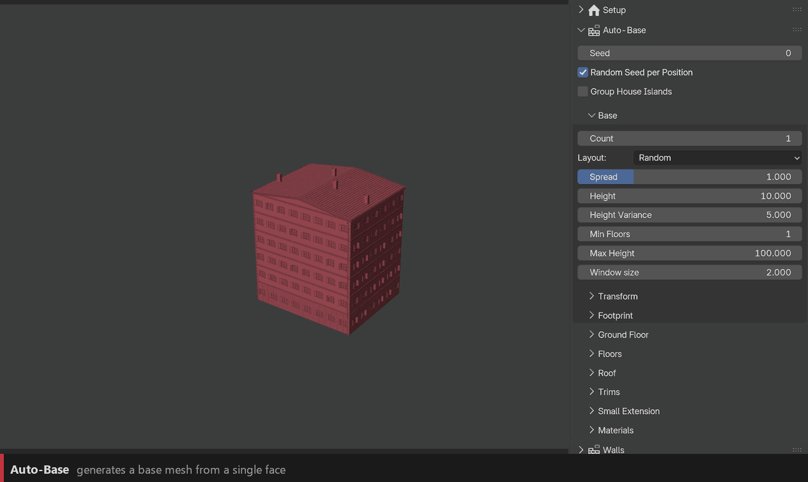
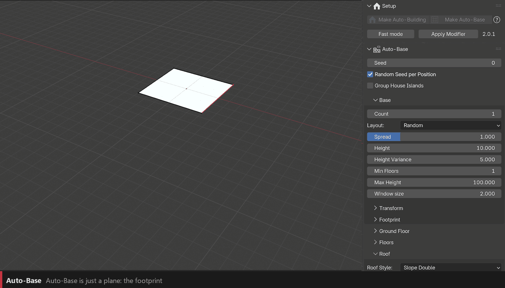
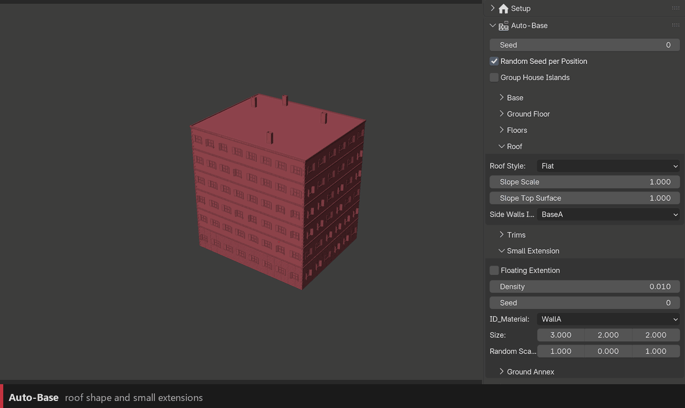

Auto-Base
=========

**Auto-Base** builds the base mesh for you: from a single face (or any flat footprint), it raises blocks, floors and a roof, and tags every face with the right ID material. Auto-Building then dresses it. Great for background buildings, quick variations and city blocks.

Getting started
---------------

1. With nothing selected, click **Setup › Make Auto-Base**: a plane with the Auto-Base modifier is created.
2. With the plane selected, click **Make Auto-Building**: the Auto-Building modifier is added **after** Auto-Base.
3. Plug your collections in the Walls, Trims and Roof panels as usual.

You can also select your own flat footprint mesh and click **Make Auto-Base** on it.

The settings live in the **Auto-Base** panel, which appears when the selected object has the modifier.

``Seed``
  A new variation of the whole base.

``Random Seed per Position``
  Each copy of the object gets its own variation depending on where it is. Duplicate the object to get a street of different buildings.

``Group House Islands``
  Treats each separate piece of the footprint as its own house.

The footprint
-------------

The mesh under Auto-Base is the **footprint** of the building. Edit it in Edit Mode, extrude edges, move vertices, and the building follows.

``Footprint › Rectilinear Grid``
  Rebuilds every footprint face with right angles, on a grid of this size, aligned to its main direction. Sketch roughly, the grid squares it up. ``0`` = off.

``Footprint › Min Building Area``
  Footprint faces smaller than this (m²) are removed. ``0`` = off.

Base
----

``Count`` / ``Layout`` / ``Spread``
  Number of blocks and how they are arranged: **Random**, or the **L-Shape**, **T-Shape**, **U-Shape** and **Courtyard** presets (they ignore Count). Spread pushes the extra blocks away from the centre.

``Height`` / ``Height Variance`` / ``Min Floors`` / ``Max Height``
  Total height of the walls, its random variation, and hard limits.

``Window Size``
  Width of one module (one window). Walls are cut into modules of this size.

``Transform``
  Random translation, rotation, scale and height per block, with their own seed.

Floors and walls
----------------

Auto-Base tags the faces with **wall categories**, which are the Base and Wall slots of Auto-Building.

``Ground Floor``
  Height and module width of the ground floor, its wall category (doors, shop fronts…), its base category, and a **Secondary Wall Probability** to mix in a second category.

``Floors``
  Height of the upper floors, and their wall and base categories.

``Materials``
  The ID materials used for each category. Leave them as they are unless you renamed the ID materials.

Roof and extensions
-------------------

``Roof › Roof Style``
  **Flat**, **Slope Single**, **Slope Double**, **Slope Pyramid** or **Slope Flat Top**. Slope Scale and Slope Top Surface shape the slopes; Side Walls sets the category of the gable walls.

``Trims``
  Which Trim channel (A–J, or None) goes on each kind of edge: horizontal floor lines, top edge, corners, inner corners, top of the ground floor, roof ridge and roof hips.

``Small Extension``
  Turn on **Floating Extension** to add small boxes on the facades (bay windows, closets…). Density, Seed, wall category, Size and Random Scale.

``Small Extension › Ground Annex``
  Small single-storey annexes against the ground floor, with a flat or lean-to roof. ``Annex Density`` = 0 turns them off.

.. tip::
   To keep editing by hand, apply the Auto-Base modifier only (modifier menu › **Apply**): you get the base mesh with all its ID materials, and Auto-Building keeps working on top.
