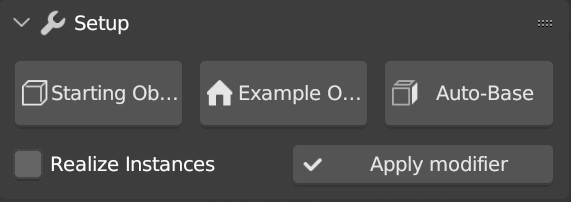
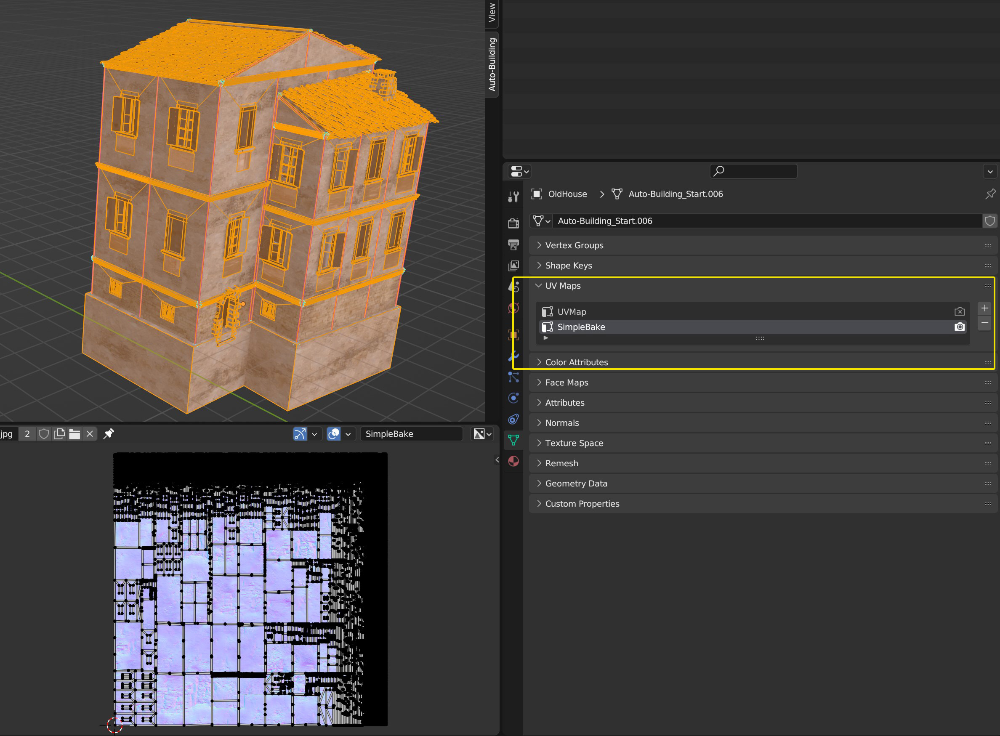
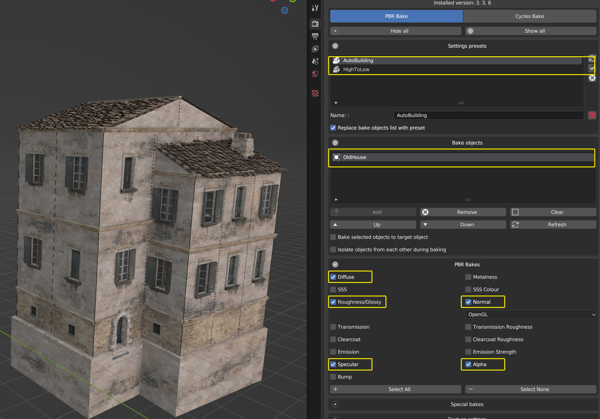
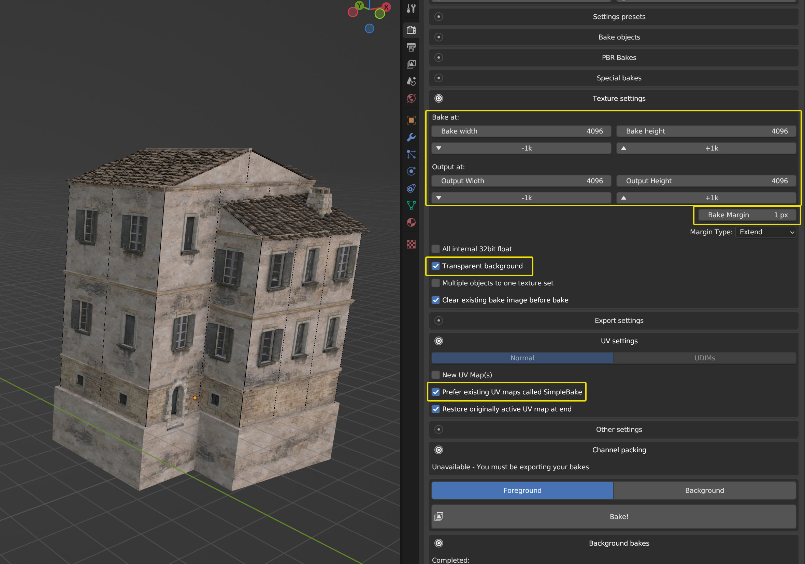
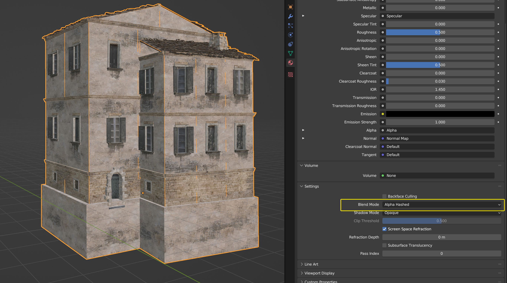
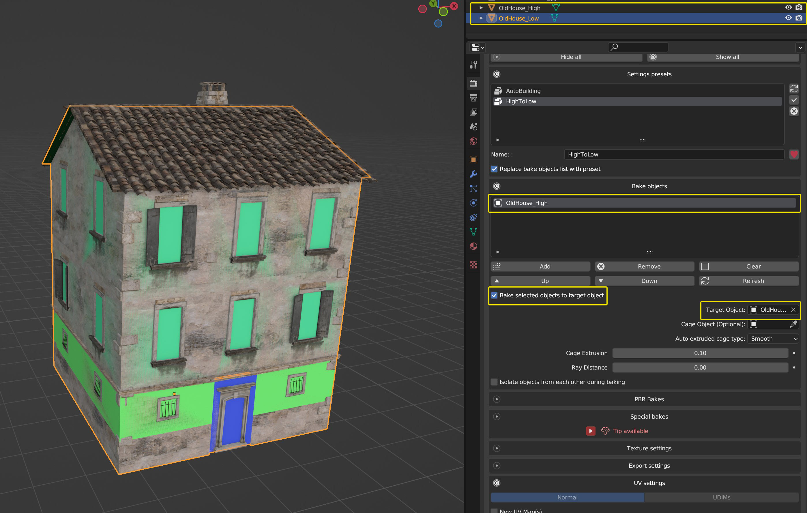
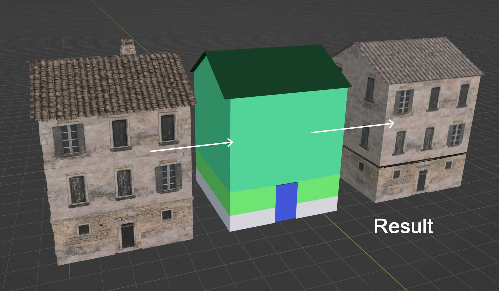

Export & Baking
===============

Applying the modifier
---------------------

There are two ways to turn your procedural building into real geometry:

**Classic apply.** Enable **Realize Instances** at the top of the modifier, then click **Apply Modifier**. You get a single mesh containing the whole building.

**Apply (Keep Instances).** This button in the Setup panel applies the building *without* losing the instancing: the shell becomes a mesh, and every instanced piece becomes a child object with **linked** mesh data — 321 roof tiles become 321 objects sharing a single mesh.
This keeps the file small and is the best starting point for game engines.

.. note::
   Apply (Keep Instances) automatically stores a hidden backup of your original object in a backup collection, so you can always go back.

Game Export
-----------

The **Export** panel gives you one-click exports tuned for the main game engines:

``Realize Instances``
  Realizes the instances before export, for a single combined mesh.

``Export Unreal (.fbx)``
  Exports the selected building as FBX with Unreal-friendly settings.

``Export Unity (.fbx)``
  Exports the selected building as FBX with Unity-friendly settings.

``Export Godot (.glb)``
  Exports the selected building as glTF binary for Godot.

Each button handles the conversion and the engine-specific axes and scale conventions for you.

Baking textures
---------------

To use the building outside of Blender, it's often a good idea to bake the textures onto the original mesh, or onto the low-poly version (the one you get when you turn the Geometry Nodes modifier off).

Here are my settings using the **Simple Bake** addon — the same result is achievable without it:

1) Apply the Geometry Nodes modifier, create a new UV map called ``SimpleBake``, and unwrap your model however you like (here I just used Smart UV Project).

2) Create a preset for easier re-use (I also keep one for baking the high poly onto the low poly).

Add your object to the **Bake objects** list and select the textures you need in the **PBR Bakes** list.

3) Here I'm baking 4K maps. Turn on **Transparent background** if your building uses transparency in the decal materials.

Make sure **Prefer existing UV maps called SimpleBake** is enabled.
In the **Other Settings** tab (not open in the screenshot), you can enable **Copy objects and apply bakes** to get the result as a copy.

4) Run the baking process by clicking **Bake!**

The decal transparency is not handled properly in Eevee here, so I switch the Blend Mode of the baked materials to **Alpha Hashed** to fix it.

5) You can also bake the high poly onto the low poly. Play with **Auto extruded cage type** and **Cage Extrusion** to improve the result.

