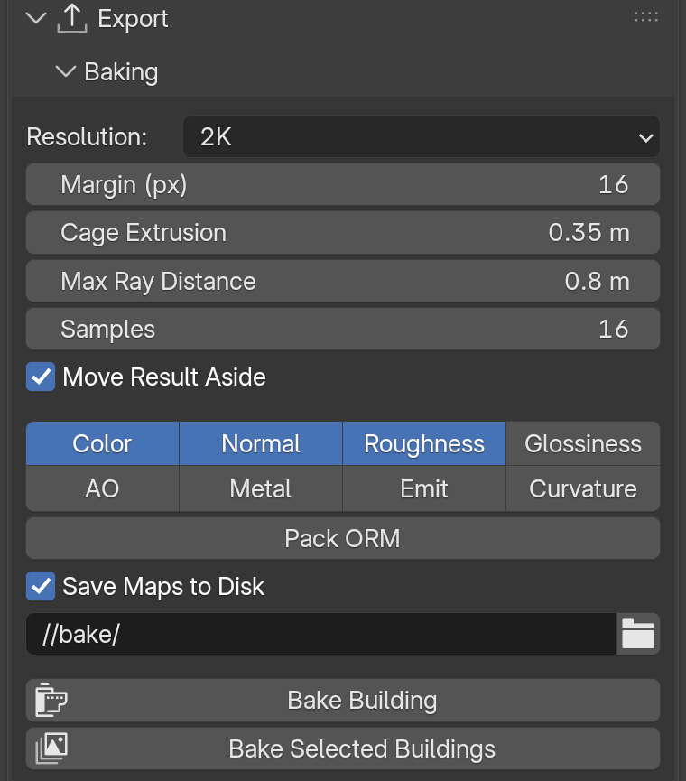

Export & Baking
===============

Three ways to take the building out of Geometry Nodes, from the lightest to the most game-ready:

- **Apply Modifier** – real objects in Blender, instancing kept.
- **Baking** – a single low-poly mesh with baked textures.
- **Game Export** – one click to a file for Unreal, Unity or Godot (see also :doc:`game-engine`).

Applying the modifier
---------------------

``Setup › Apply Modifier``
  Applies the building **without losing the instancing**. The shell becomes a mesh, and every placed piece becomes a child object that **shares its mesh** with the identical pieces: 321 roof tiles become 321 objects using one single mesh. Light files, and the best starting point for a game engine.

  A hidden copy of the original procedural object is kept in the ``AB_APPLY_BACKUP`` collection, so you can always go back.

**Classic apply.** Turn on **Config › Realize Instances**, then use **Apply** in the modifier menu. You get one single mesh with everything merged. Simple, but heavy.

Baking
------

**Export › Baking** bakes the whole building onto a light low-poly mesh, with Cycles, in one click. Perfect for background buildings, mobile and VR.

What **Bake Building** does:

1. Takes the full building as the high-poly source.
2. Builds the low-poly target: the **Bake Mesh** output when the building has one, otherwise the base mesh. Parts flagged **Keep in Bake Mesh** (trims, supports, facade props…) stay as real geometry.
3. Unwraps it with large UV islands.
4. Bakes the maps (lighting-free) and builds a material with them. Alpha decals are composited correctly.
5. Creates ``<name>_BAKE_LOW`` next to the original.

``Resolution``
  Size of the maps: 1K, 2K or 4K.

``Margin (px)``
  Bleed around the UV islands, so no seams show at a distance.

``Cage Extrusion`` / ``Max Ray Distance``
  How far the bake looks out from and into the low-poly surface. Raise them when deep parts (balconies, deep windows) come out missing or black.

``Samples``
  Cycles samples per pixel. 16 is enough for colour and normal; raise for AO.

``Move Result Aside``
  Places the baked object beside the original instead of on top of it.

``Color`` / ``Normal`` / ``Roughness`` / ``Glossiness`` / ``AO`` / ``Metal`` / ``Emit`` / ``Curvature``
  The maps to bake. Glossiness is the inverted roughness; Curvature is derived from the normal map (an edge and cavity mask for wear).

``Pack ORM``
  Also writes an ORM map (R = AO, G = Roughness, B = Metallic), the standard for glTF and Unreal.

``Save Maps to Disk``
  Writes the maps as images in the folder below (``//bake/`` = next to the ``.blend``).

``Bake Building`` / ``Bake Selected Buildings``
  Bakes the active building, or every selected one in a row.

.. tip::
   Baking takes time: save your file first, and start with 1K to check the result.

Game Export
-----------

**Export › Game Export** writes the selected buildings to a file ready for a game engine: the shell, the pieces as shared meshes, and materials the engine can read.

.. image:: images/panel_game_export.png
   :alt: Game Export panel
   :width: 420px

``Engine``
  **Unreal**, **Unity** or **Godot**. Sets the naming, the axes and the default format.

``Format``
  **Auto** picks the best one: glTF for Unreal and Godot, FBX for Unity. **glTF (.glb)** carries real PBR materials with embedded textures. **FBX** is the legacy format.

``Output``
  Folder of the exported files. ``//export`` = an ``export`` folder next to the ``.blend``.

``Mode``
  **Instanced**: the shell plus one mesh per unique piece, placed many times. Small files, instancing in the engine. **Merged**: everything joined into one mesh per building. Simplest import, biggest file.

``Game Materials``
  Engines only read a texture plugged **straight** into the Principled BSDF. With this on, each material is replaced on the exported copy by a simple ``_Game`` twin with the colour, roughness, metallic and normal images wired directly. Your Blender materials are never changed.

``Flip Normal Green (FBX only)``
  Converts normal maps to the DirectX convention Unreal expects. Only for Unreal with FBX; leave it on unless your normal maps are already DirectX.

``Bake Missing Channels`` / ``Bake Size``
  When a channel has no image (a tinted colour, a ColorRamp, a Bump node, a procedural texture), it is baked to a texture so it survives the export.

``Export Unreal / Unity / Godot``
  Exports. The button shows the engine and the file type.

Baking by hand
--------------

You can also bake with Blender's own tools, for full control:

1. Turn on **Config › Realize Instances** and duplicate the building as the high poly; apply its modifier.
2. Duplicate the base mesh as the low poly and unwrap it (**UV › Smart UV Project**).
3. Give the low poly a material with an empty **Image Texture** node, selected.
4. In **Render Properties**, switch to **Cycles** and open **Bake**: pick the bake type, turn on **Selected to Active**, set **Extrusion** and **Max Ray Distance**.
5. Select the high poly, then the low poly (active), and click **Bake**. Save the image.
