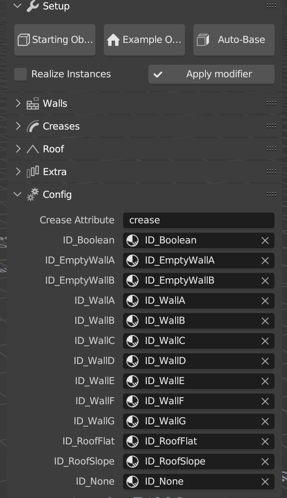

Config
======

Global switches
---------------

At the very top of the modifier you'll find a few global controls:

``Realize Instances``
  Converts all instances into real geometry. **Required before applying the modifier** or exporting.

``Master Seed``
  One seed to randomize the whole building at once.

``Fast Mode``
  Disables the heaviest computations for faster viewport feedback while you work.

Settings
--------

Normally you won't need to touch this panel, but it's useful to check when something doesn't work properly.

The most common problem is **duplicated materials** in the scene, with the tool looking for the wrong one (e.g. ``ID_Boolean.001``).
Make sure the materials assigned to your building and the Boolean material on your parts are the exact same datablocks listed in this panel.

``Version``
  Version of the Auto-Building system in this file.

``Horizontal/Vertical Edge detection threshold``
  Angle used to decide if an edge counts as horizontal or vertical for the Trim system.

``Attribute Bottom / Top / Corners Out / Corners In``
  Names of the attributes output by the system, in case you need them in your materials or other modifiers.

``Uvmap Name``
  Name of the UV map generated by the system.

``Window ID Attribute``
  Name of the attribute identifying the window instances.

``Building ID Attribute`` / ``Building ID Seed``
  Writes a random value, unique per building, as an attribute. Use it in your materials to vary colours between buildings. Change the seed to get another value.

``ID materials``
  The list of ID material slots used by the system: ``ID_Boolean``, ``ID_BaseA`` to ``ID_BaseD``, ``ID_WallA`` to ``ID_WallJ``, ``ID_RoofFlat``, ``ID_RoofSlope``, ``ID_Decals`` and ``ID_None``.

LOD
---

A built-in level-of-detail system for game or heavy-scene workflows.

``LOD Enable``
  Enables the LOD system.

``LOD Mode``
  **Auto** switches automatically based on the camera distance; **LOD 0** to **LOD 3** force a specific level.

``LOD Distance 1 / 2 / 3``
  Camera distances at which the building switches to the next level in Auto mode.
