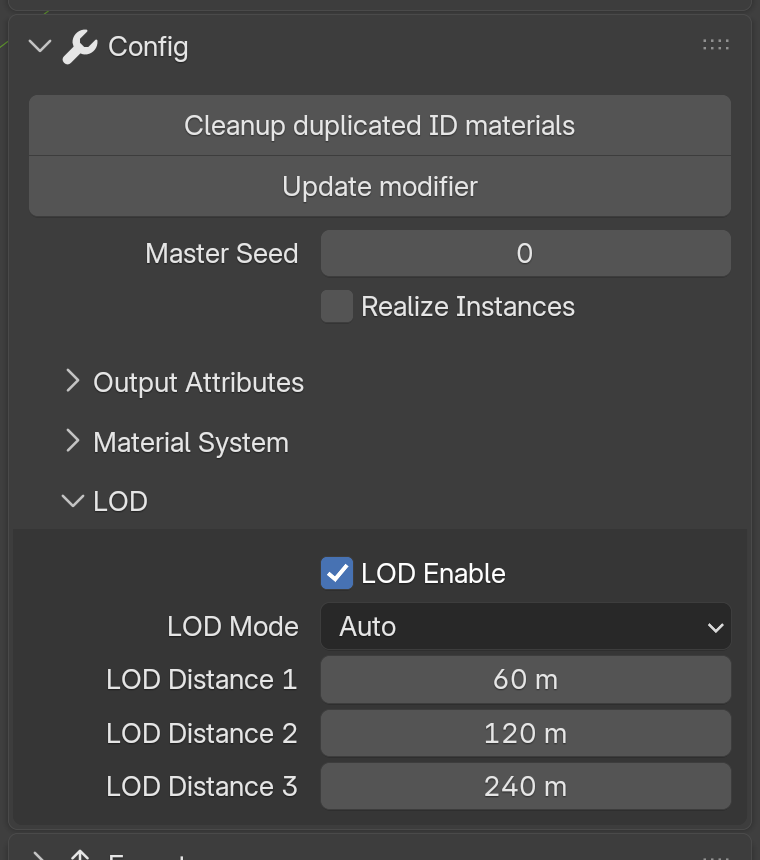
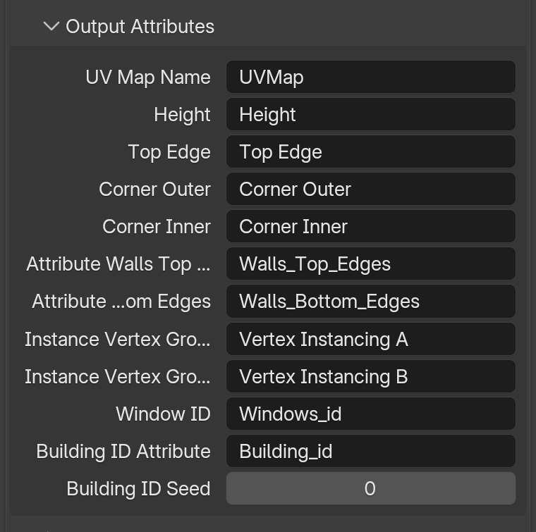

Config
======

Global settings of the selected building, plus maintenance tools. You rarely need this panel, but it is the first place to look when something doesn't behave.

Tools and global switches
-------------------------

``Cleanup duplicated ID materials``
  Merges duplicated ID materials (``ID_Boolean.001``, ``ID_WallA.002``…) and duplicated node groups back into the originals. Use it after appending or importing buildings from another file.

``Update modifier``
  Updates **every** Auto-Building modifier in the file to the version shipped with the installed add-on. Settings are kept.

``Master Seed``
  One seed added to all the other seeds: a new random version of the whole building in one click.

``Realize Instances``
  Turns every instance into real geometry. Needed before a classic **Apply** of the modifier (see :doc:`baking`). Leave it off while working: instances are much lighter.

Output Attributes
-----------------

Names of the attributes written on the building, to use in your shaders (with an **Attribute** node) or in other modifiers.

``UV Map Name``
  Name of the UV map generated on the walls and roofs.

``Height`` / ``Top Edge``
  Height of each point, and a mask of the top edges of the walls (for dirt or moss on top).

``Corner Outer`` / ``Corner Inner``
  Masks of the outer and inner corners (for worn corners).

``Attribute Walls Top Edges`` / ``Attribute Walls Bottom Edges``
  Masks along the top and bottom edges of the walls.

``Instance Vertex Group A`` / ``B``
  Names of the vertex groups read by :doc:`facade` › Instancing on Vertex.

``Window ID``
  A random value per window instance, to vary lit windows or curtains.

``Building ID Attribute`` / ``Building ID Seed``
  A random value (0–1), stable and unique per building. Plug it in a Color Ramp to vary colours from one building to the next. Change the seed, or the Master Seed, to reshuffle it.

Material System
---------------

The list of **ID materials** the system reads: ``ID_Boolean``, ``ID_BaseA``–``D``, ``ID_WallA``–``J``, ``ID_RoofFlat``, ``ID_RoofSlope``, ``ID_Decals`` and ``ID_None``. See :doc:`id-materials`.

.. warning::
   The faces of your building, and the boolean shapes of your parts, must use **these exact materials**. A copy such as ``ID_WallA.001`` is ignored and nothing appears. Click **Cleanup duplicated ID materials**, or pick the right material here.

LOD
---

A built-in level of detail system, for game engines and big scenes.

``LOD Enable``
  Turns the LOD system on.

``LOD Mode``
  **Auto** switches the level with distance; **LOD 0** to **LOD 3** force one level (0 = full detail).

``LOD Distance 1`` / ``2`` / ``3``
  Distances where the building switches to the next level in Auto mode.

.. tip::
   For a game export, force each LOD level, export, and name the files ``_LOD0``, ``_LOD1``… for the engine. See :doc:`game-engine`.

Trim settings
-------------

The angle that decides whether an edge is a **horizontal** or a **vertical** trim lives in **Trims › Settings › H/V Threshold** (see :doc:`trims`).
