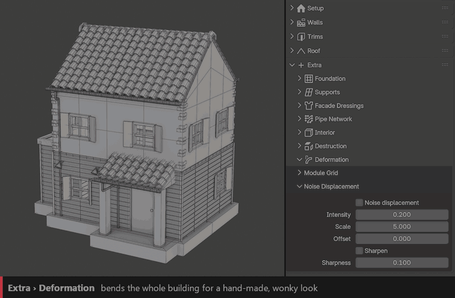

Deformation
===========

Bends the whole building for a hand-made, wonky or old look.

Noise Displacement
------------------

``Noise Displacement``
  Warps the building with a 3D noise.

``Intensity``
  Strength of the warp.

``Scale``
  Size of the noise waves. Lower values give big, slow bends.

``Offset``
  Shifts the noise to get another variation.

``Sharpen`` / ``Sharpness``
  Keeps edges crisp after the displacement.

Module Grid
-----------

Snaps the base mesh to a regular grid before the building is generated. Handy to clean up a roughly modelled base.

``Grid Snap``
  Turns the grid snapping on.

``Module X`` / ``Floor Height``
  Grid size horizontally and per floor.

``Plumb Walls`` / ``Snap Floors``
  Makes walls perfectly vertical, and snaps floor levels to the grid.

``Min Face Size``
  Faces smaller than this are left alone.

.. tip::
   For smooth bends, give the walls enough resolution with **Wall Subdivision** or **Output Subdivision** (see :doc:`walls`).
