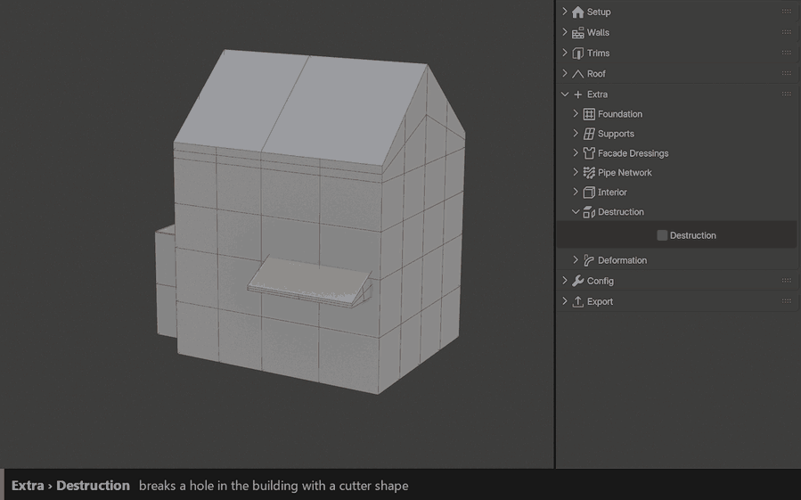
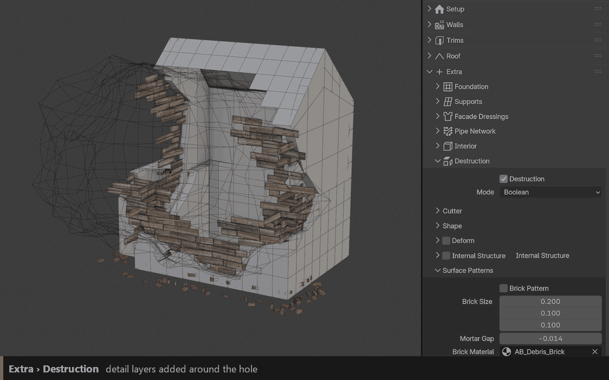

Destruction
===========

Breaks a hole in the building with a cutter shape: broken walls, exposed structure, bricks and planks along the break, and debris piling up below. Perfect for ruins and abandoned places.

``Destruction``
  Turns destruction on.

``Mode``
  **Simple** or **Boolean** (a cutter shape you can move).

Cutter
------

``Boolean Translation`` / ``Rotation`` / ``Scale``
  Position, rotation and size of the cutter. Bigger scale = bigger hole.

``Boolean Visibility``
  Shows the cutter as a wireframe preview in the viewport.

``Cut Material``
  Material of the cut surfaces.

Shape
-----

Makes the border of the hole irregular instead of a clean cut: large and small noise, randomness, an open or filled rim, and the thickness of solid walls.

Detail layers
-------------

``Deform``
  Crumbles and bends the broken edges, and can make the area around the hole sag (Collapse).

``Internal Structure``
  Beams inside the cut walls, with optional diagonal beams.

``Surface Patterns``
  **Brick Pattern** and **Plank Pattern**: rows of bricks or boards exposed along the break, as if the wall were built of them. **Spread** sets how far they reach from the cut line; size, gap, offset, length variation and random transform shape the courses.

Debris
------

Rubble that falls and piles up below the hole.

``Type``
  **Collection** (your own objects), **Brick** or **Plank**.

``Density`` / ``Scale`` / ``Seed``
  Amount, size and layout of the debris.

``Random Translate / Rotation / Scale`` / ``Uniform Scale Min / Max``
  Random variation per piece.

Advanced
--------

``Process Region Only`` / ``Process Radius``
  Only computes the destruction around the cutter. Much faster on big buildings.

``Cut Detail``
  Resolution of the broken border.

``Delete Floating`` / ``Floating Max Size``
  Removes small pieces left floating in the air.

``Distance Attribute``
  Writes the distance to the hole as an attribute, so your materials can add dirt, burn marks or exposed plaster near the damage.
