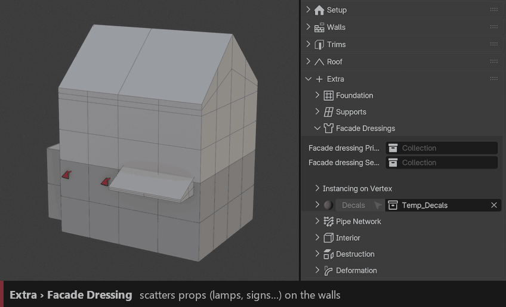
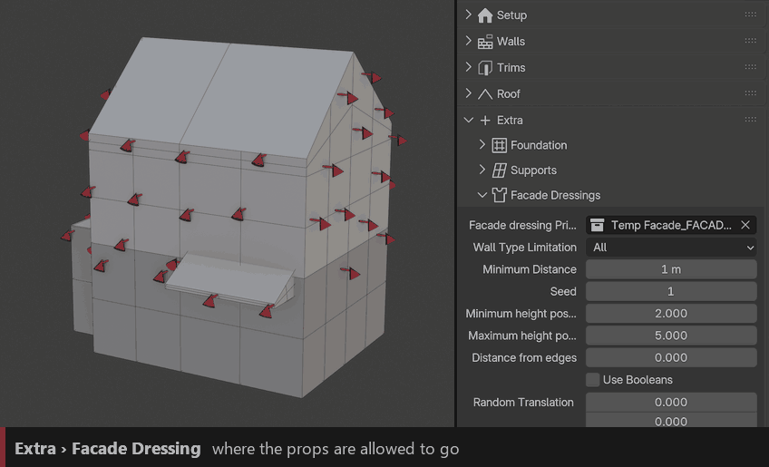
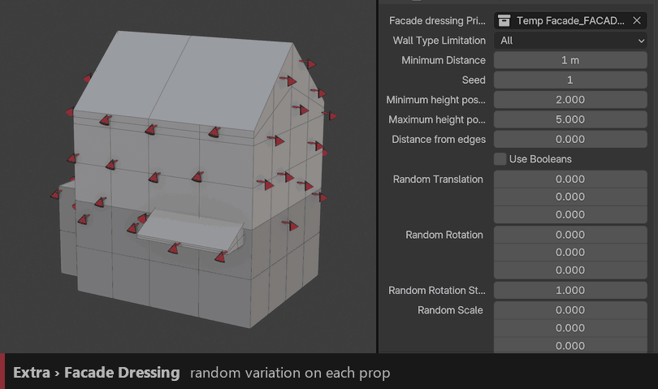
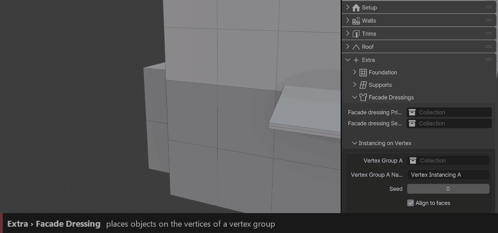
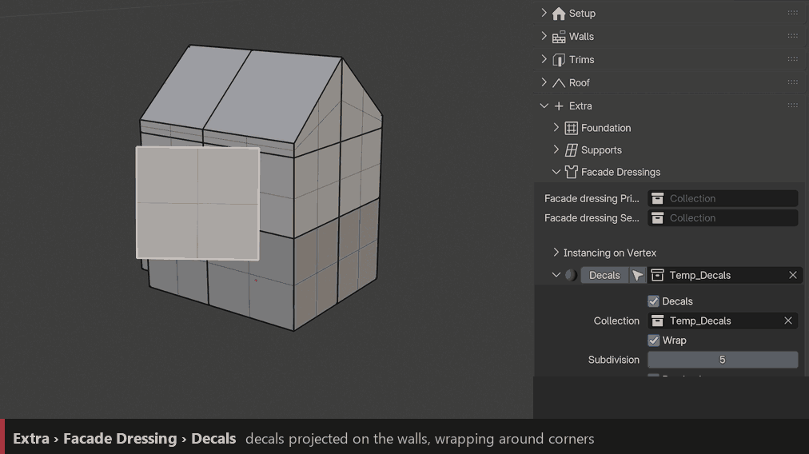

Facade Dressing
===============

Scatters small props on the walls: lamps, signs, AC units, flower pots… There are two independent layers, **Primary** and **Secondary**, with the same settings, plus **Instancing on Vertex** for precise placement.

Primary / Secondary
-------------------

``Collection``
  Objects to scatter. The settings appear once a collection is set.

``Wall Type Limitation``
  Only on one Base (A–D), or on **All** walls.

``Minimum Distance``
  Space between the props. Lower values give more props.

``Seed``
  New random layout.

``Use Booleans``
  The props' ``ID_Boolean`` shapes cut the walls.

Placement
~~~~~~~~~

``Minimum Height`` / ``Maximum Height``
  Height range where props can be placed, for example to keep them above the ground floor.

``Distance from Edges``
  Keeps props away from the wall corners.

Random
~~~~~~

``Random Translation`` / ``Random Rotation`` / ``Random Rotation Step`` / ``Random Scale``
  Random variation per prop. Rotation Step snaps the random rotation to steps.

Instancing on Vertex
--------------------

Places objects exactly on the vertices of a vertex group. Four slots, **A to D**.

``Vertex Group A–D``
  Collection placed on the vertices of the named vertex group (``Vertex Instancing A`` by default).

``Seed``
  Picks another object of the collection per vertex.

``Align to Faces``
  Aligns the objects to the nearest wall. Off: the objects stay upright.

``Keep in Bake Mesh``
  Includes them when baking the building to a mesh (see :doc:`baking`).

Decals
------

Projects decal objects (dirt, leaks, posters, graffiti…) onto the walls. Decals wrap around corners.

1. In Edit Mode, add a plane in front of the wall where you want the decal.
2. Select it and click the **Decals** button: it gets the ``ID_Decals`` material and becomes a projected decal.
3. Move or scale the plane to place the decal; it slides along the wall and wraps around the corner.

``Collection``
  The decal objects.

``Wrap`` / ``Subdivision``
  Wraps the decals around the surface, with enough resolution to follow it.

``Randomize`` / ``Seed``
  Random decal choice.
