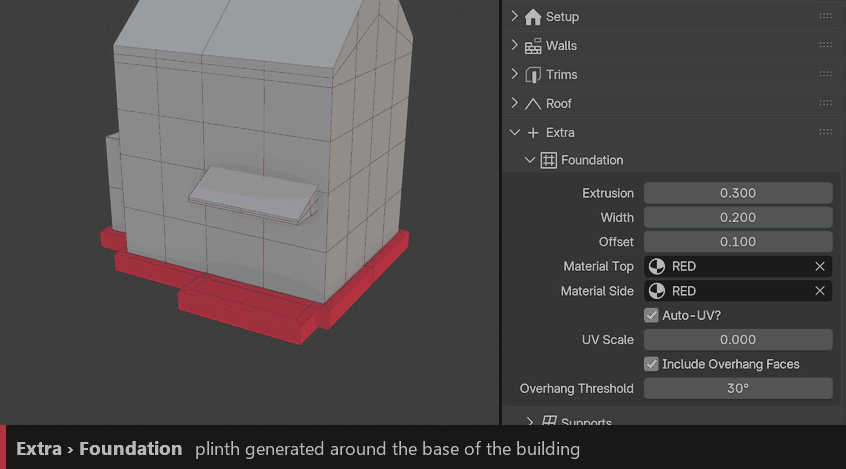
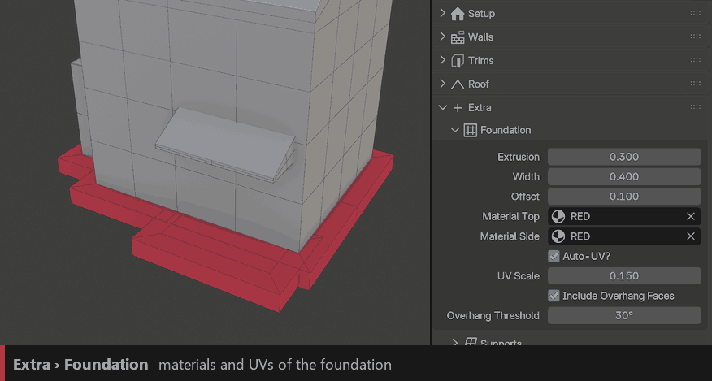

Foundation
==========

Extrudes the bottom of the building into a plinth. Useful to hide the gap when the ground is not flat.

``Extrusion``
  How deep the foundation goes down. Set it to 0 to turn the foundation off.

``Width``
  How far the foundation sticks out from the walls.

``Offset``
  Raises the foundation up the walls.

``Include Overhang Faces`` / ``Overhang Threshold``
  Also builds a foundation under parts of the building that overhang, from this angle.

Materials and UVs
-----------------

``Material Top`` / ``Material Side``
  Materials of the top faces and of the outer sides.

``Auto-UV`` / ``UV Scale``
  Automatic UVs and texture size. With Auto-UV off, the raw (stretched) UVs are kept.
