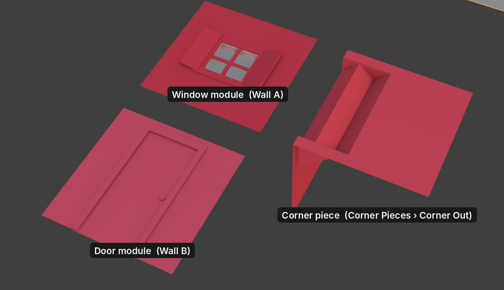
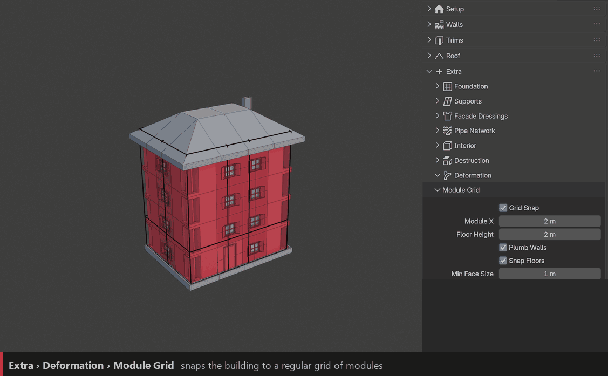
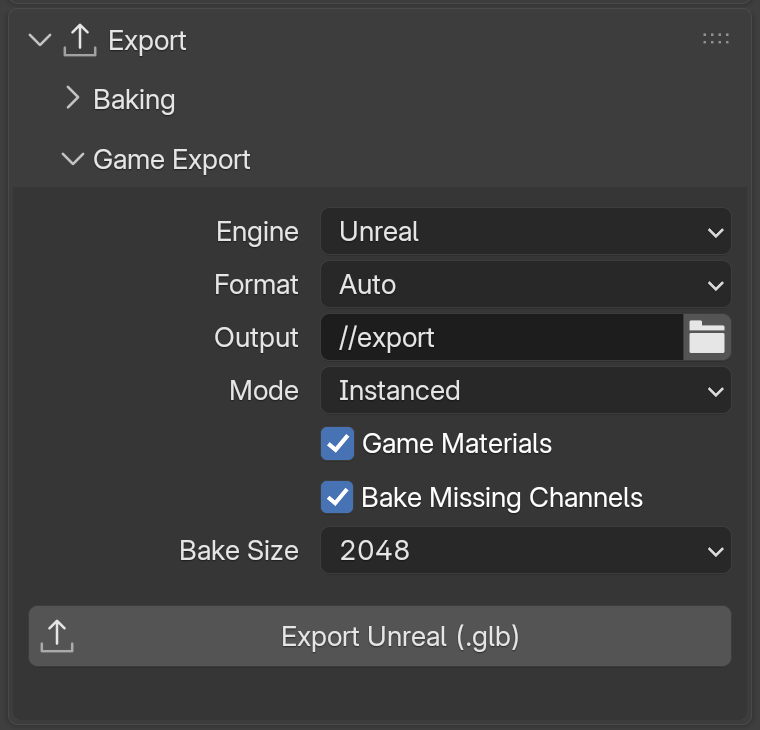

Game Engine Workflow
====================

Auto-Building can produce clean, light buildings for **Unreal**, **Unity** and **Godot**. This page puts the useful pieces together, from the kit to the import.

1. Build a modular kit
----------------------

Game buildings are usually made of **modules**: wall panels of a fixed size that snap together. Model your windows, doors and corner panels on the same module size (for example 2 m wide, one floor high).

- Window and door panels go in **Wall A**, **Wall B**…
- The corner panel goes in **Corner Pieces › Corner Out** of the wall (see :ref:`walls-corner-pieces`).
- Use **Wall Model** for plain wall panels (see :doc:`walls`).

2. Snap the building to the grid
--------------------------------

Turn on **Extra › Deformation › Module Grid** with the same module size. The building always lands on whole modules, so every panel fits without stretching.

3. Keep it light
----------------

- **Instances stay instances**: every repeated piece is exported once and placed many times.
- **Fast mode** while working, off before exporting.
- **LOD**: Config › LOD gives up to four levels of detail. Force **LOD 0** to **LOD 3** and export each one for the engine's LOD system (see :doc:`config`).
- For far-away buildings, **Export › Baking** turns the building into one low-poly mesh with baked textures (see :doc:`baking`).

4. Export
---------

Select the buildings and use **Export › Game Export**.

.. list-table::
   :header-rows: 1
   :widths: 18 22 60

   * - Engine
     - Default format
     - Import
   * - Unreal 5
     - glTF (.glb)
     - **File › Import Into Level**. Interchange keeps the shared pieces as one Static Mesh each.
   * - Unity
     - FBX
     - Drag the file into the Project. Unity has no built-in glTF importer (glTF needs the glTFast or UnityGLTF package).
   * - Godot 4
     - glTF (.glb)
     - Drag the file into the FileSystem dock; glTF is native.

Use **Mode › Instanced** for small files and engine-side instancing, or **Merged** for one mesh per building. Keep **Game Materials** on: the engine then reads your colour, roughness, metallic and normal textures directly. All settings are described in :doc:`baking`.

.. tip::
   Prefer to stay in Blender a bit longer? **Setup › Apply Modifier** gives real objects with linked meshes, ready for any exporter.
