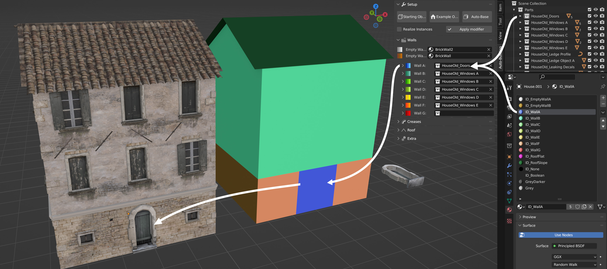

.. image:: images/CoverIlustration.jpg

Welcome!
========

Welcome to the Auto-Building documentation!

.. note::
   **This version of the addon requires Blender 4.5 or above.**

.. note::
   **Auto-Building runs entirely on Geometry Nodes. The addon itself is optional, but it provides a much nicer interface along with several useful helper actions.**

Introduction
------------

Auto-Building starts from a simple low-poly mesh and procedurally replaces its faces with building elements, letting you create detailed structures in minutes.

Even though the result can look complex, it stays easy to edit and iterate on: everything is handled procedurally by Geometry Nodes, so the original mesh remains your control surface.

The workflow in short:

1. Model your building parts (windows, doors, balconies, etc.) and organize them into dedicated collections.
2. Assign each collection to a category, either through the addon panel or directly in the Geometry Nodes modifier.
3. Select faces on your base mesh and use the assignment buttons in the addon interface — the system instantly spawns objects from the corresponding collection on those faces.

Under the hood, each button simply assigns an ID material to the selected faces, so you can always do the same thing manually through the material slots.

There is a lot more to discover, and this documentation covers every setting.
Feel free to open the Sample scene to see what is possible and how it all works :D

.. toctree::
   :maxdepth: 2
   :hidden:
   :caption: 🚀 Start

   installation
   Setup
   Buildingparts

.. toctree::
   :maxdepth: 2
   :hidden:
   :caption: 🏠 Core

   walls
   trims
   roofs

.. toctree::
   :maxdepth: 2
   :hidden:
   :caption: ✨ Systems

   foundation
   supports
   facade
   pipes
   interior
   destruction
   deformation

.. toctree::
   :maxdepth: 2
   :hidden:
   :caption: ⚙️ Advanced

   config
   autobase
   baking

.. toctree::
   :maxdepth: 2
   :hidden:
   :caption: ✉️ Contacts

   credit
