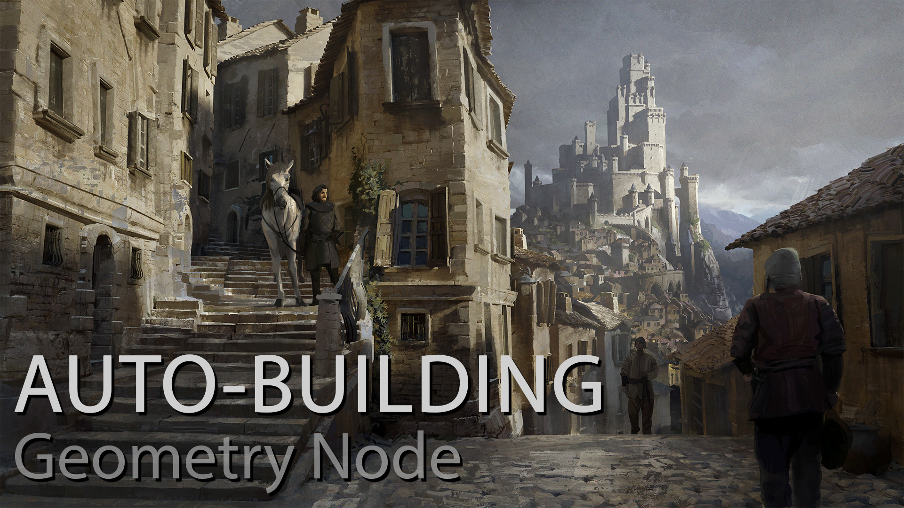
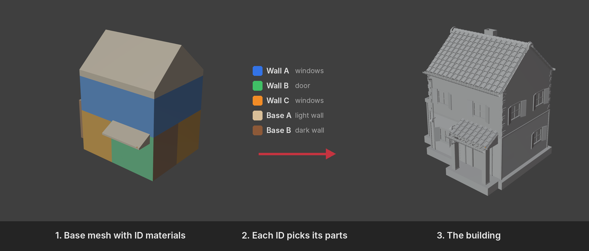

Welcome
=======

**Auto-Building** turns a simple low-poly mesh into a detailed building. You model the rough shape, tag its faces and edges, and Geometry Nodes fill them with walls, windows, trims, roofs and props.

.. note::
   **Requires Blender 5.0 or newer** (tested on 5.0, 5.1 and 5.2).

The original mesh stays your control surface: move a wall, extrude a floor, and the building follows.

How it works
------------

1. **Model the parts** (windows, doors, balconies…) and put each kind in its own collection.
2. **Plug the collections** into the Auto-Building panel (Walls, Trims, Roof…).
3. **Tag the base mesh**: select faces or edges and click a button. The matching objects appear on them instantly.

Each button only assigns an **ID material** to the faces (or a crease value to the edges), so you can always do the same by hand. See :doc:`id-materials`.

Where to start
--------------

- New here? Follow the :doc:`quickstart`, five minutes from a cube to a building.
- Installing: :doc:`installation`.
- Making your own parts: :doc:`Buildingparts`.
- Sending the building to Unreal, Unity or Godot: :doc:`game-engine`.
- Something looks wrong: :doc:`troubleshooting`.

.. toctree::
   :maxdepth: 2
   :hidden:
   :caption: 🚀 Start

   installation
   quickstart
   Setup
   Buildingparts
   id-materials

.. toctree::
   :maxdepth: 2
   :hidden:
   :caption: 🏠 Core

   walls
   trims
   roofs

.. toctree::
   :maxdepth: 2
   :hidden:
   :caption: ✨ Systems

   foundation
   supports
   facade
   pipes
   interior
   destruction
   deformation

.. toctree::
   :maxdepth: 2
   :hidden:
   :caption: ⚙️ Advanced

   autobase
   config
   baking
   game-engine
   troubleshooting

.. toctree::
   :maxdepth: 2
   :hidden:
   :caption: ✉️ Contacts

   credit
