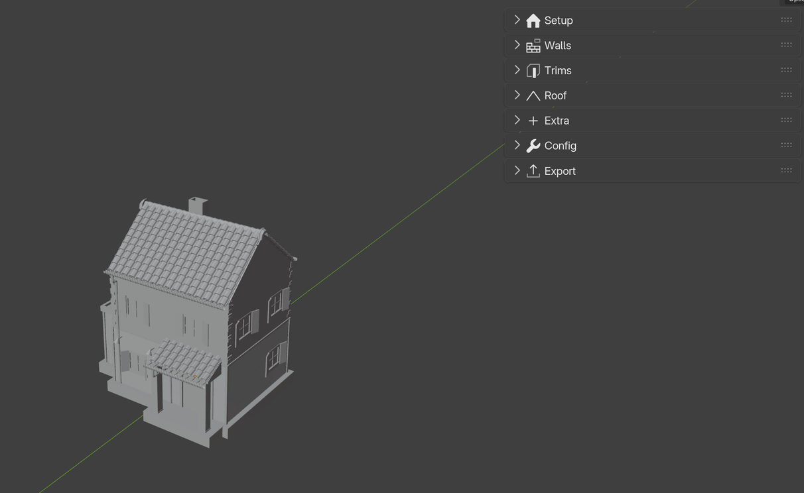

Installation
============

.. _installation:

Add-on
------

Auto-Building is a Blender **extension** (a ``.zip`` file). **Requires Blender 5.0 or newer.**

1. Open **Edit › Preferences › Get Extensions**.
2. Click the **⌄** menu in the top-right corner and choose **Install from Disk…**
3. Pick the Auto-Building ``.zip``. The add-on is enabled right away.

.. tip::
   You can also **drag and drop** the ``.zip`` into the Blender window.

A new **Auto-Building** tab appears in the 3D Viewport sidebar (``N``). It shows the settings of the selected building.

.. note::
   Auto-Building runs entirely on Geometry Nodes. The add-on is the interface: it adds the panels, the assignment buttons and the export tools. A building opened without the add-on still works through its modifier.

Updating
--------

1. Install the new ``.zip`` the same way; it replaces the old version.
2. In a file made with an older version, select a building and click **Config › Update modifier**. Every building in the file is switched to the new node tree; your settings are kept.

Buildings made with Auto-Building 1.x (modifier named ``GN_Auto-Building``) show an **Update** panel at the top of the tab with the same button.

Asset Browser presets
---------------------

Ready-made buildings come in the **Auto-Building Presets** ``.blend`` file. They are marked as assets, so you can drag them into any scene.

1. Copy the Presets file into a folder of your choice.
2. In **Edit › Preferences › File Paths › Asset Libraries**, click **+** and add that folder.
3. In an **Asset Browser** editor, pick the new library.

.. image:: images/AssetBrowser.jpg
   :alt: Presets in the Asset Browser

Drop a preset in the scene and edit it, or use it as a reference for your own style.
