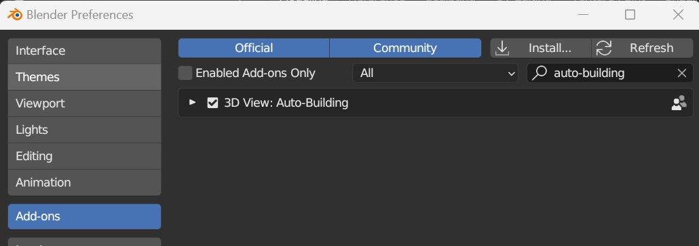
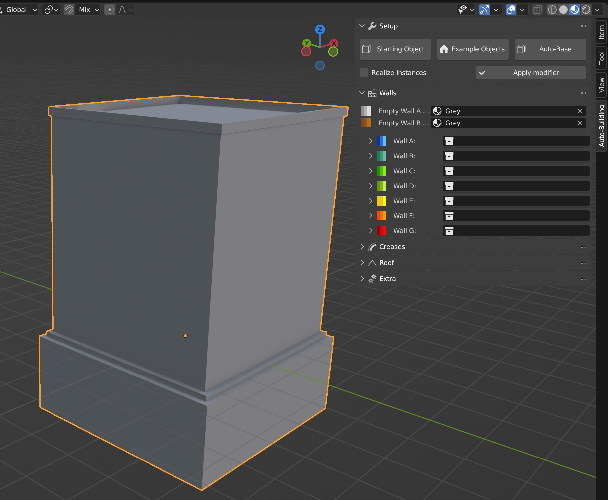
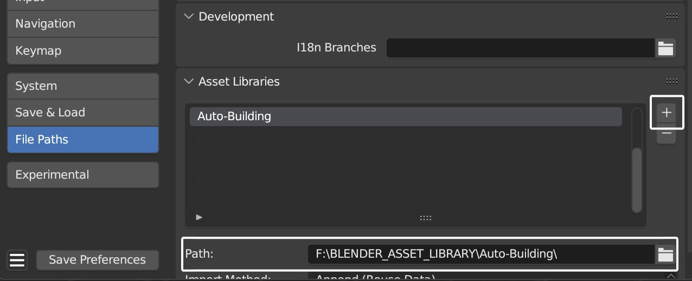
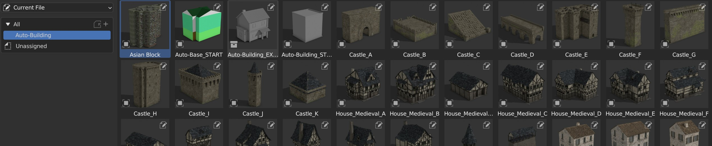

Installation
============

.. _installation:

Addon
-----

Auto-Building comes with a custom interface that simplifies the creation process.
To install it, go to:
**Top menu** → **Edit** → **Preferences** → **Add-ons** → **Install**.

Select the **addon zip file** and make sure the Auto-Building addon is enabled.

A new tab called **Auto-Building** now appears in the viewport side panel (shortcut ``N``).
This tab shows the Auto-Building Geometry Nodes settings of whichever building you select.
It also lets you create a starting base from a simple template, with all the materials already set up.

Asset Browser
-------------

The system also comes with a set of example buildings. They are marked as Assets, so you can add the Presets blend file to your own Asset Browser for quick access.

To install them, simply copy the Auto-Building Presets blend file into your personal library folder, then add that folder as a new file path in your Asset Browser preferences:

