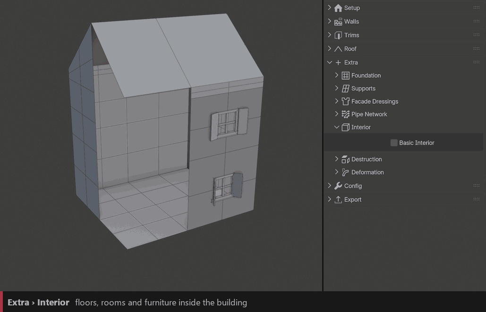
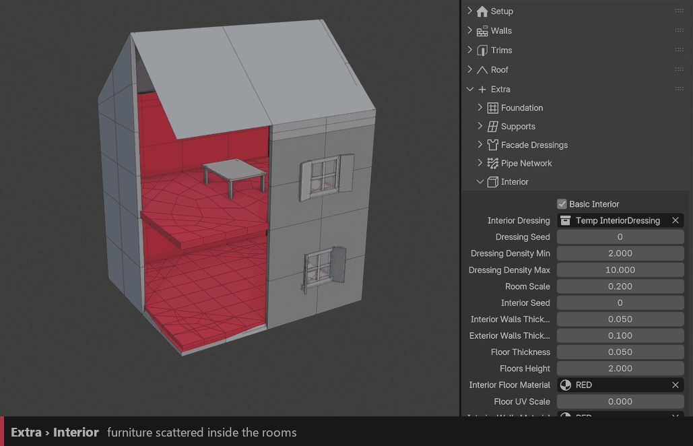

Interior
========

Builds a light interior inside the building: floors, inner walls and furniture. Seen through windows and open walls, it gives the building believable depth.

``Basic Interior``
  Adds floors and inner walls.

``Floors Height``
  Height of each storey.

``Room Scale`` / ``Interior Seed``
  Size of the rooms, and a new room layout.

``Floor Thickness`` / ``Interior Walls Thickness`` / ``Exterior Walls Thickness``
  Thickness of the slabs, the partitions and the outer shell.

``Interior Floor Material`` / ``Interior Walls Material``
  Materials of the floors and walls, each with a UV Scale.

Dressing
--------

Furniture and props scattered in the rooms.

``Interior Dressing``
  Collection of furniture.

``Dressing Density Min`` / ``Dressing Density Max``
  Spacing range between the objects. Lower values add more furniture.

``Dressing Seed``
  New furniture layout.

.. tip::
   The interior is only visible where the walls are open. Use ``ID_Boolean`` shapes on your windows and doors, or the :doc:`destruction` cutter.
