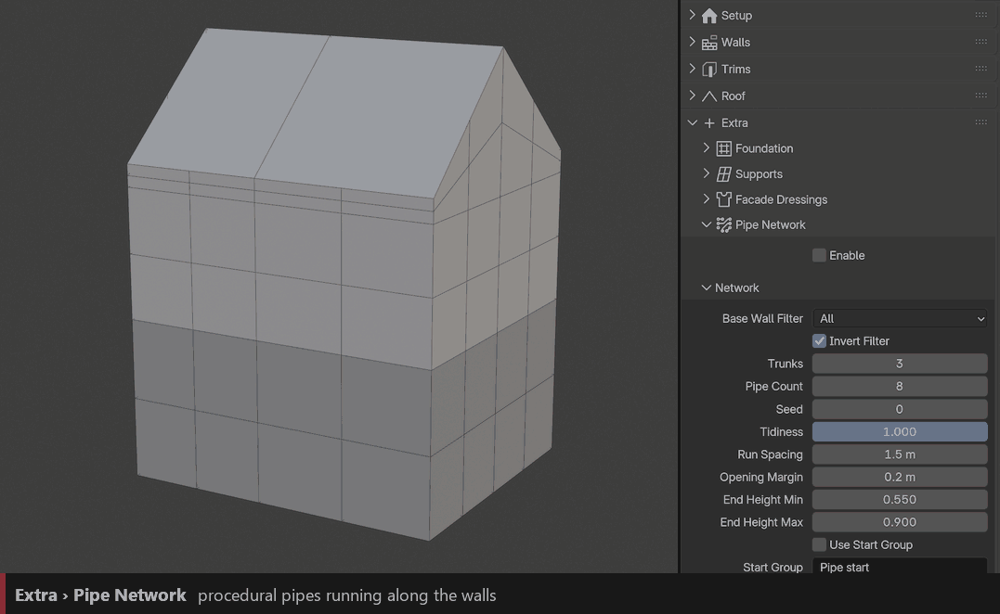
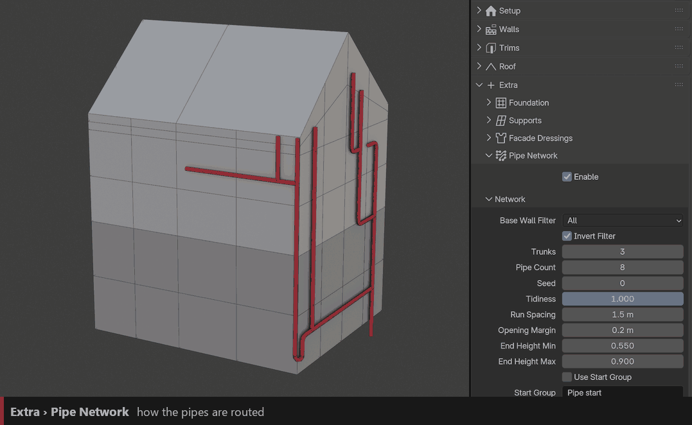
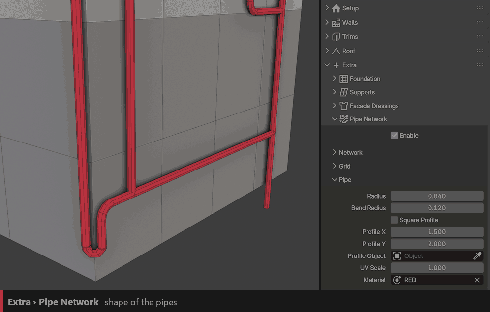

Pipe Network
============

Grows a procedural network of pipes on the walls: drainpipes, industrial piping, cables…

``Enable``
  Turns the pipe network on.

``Trunks``
  Number of main vertical pipes.

``Pipe Count``
  Number of branches.

``Seed``
  New random layout.

``Base Wall Filter`` / ``Invert Filter``
  Only on one Base (A–D), or everywhere except it.

Layout
------

``Tidiness``
  1 gives neat, straight runs. Lower values give messier routing.

``Run Spacing``
  Distance between parallel runs.

``Opening Margin``
  Keeps pipes away from windows and doors.

``End Height Min`` / ``End Height Max``
  Height range where the pipe ends stop.

``Use Start Group`` / ``Start Group``
  Starts the pipes from the vertices of a vertex group (``Pipe start`` by default).

Grid
~~~~

The pipes are routed on a grid projected on the walls.

``Grid Size``
  Grid resolution.

``Wrap Corners`` / ``Include Roof``
  Lets pipes go around corners and onto the roof.

``Wall Offset``
  Gap between the pipes and the wall.

Pipe
----

``Radius``
  Thickness of the pipes.

``Bend Radius``
  Roundness of the elbows.

``Square Profile`` / ``Profile X`` / ``Profile Y``
  Rectangular ducts instead of round pipes, with their width and height.

``Profile Object``
  Custom curve used as the pipe profile.

``Material`` / ``UV Scale``
  Material and UVs of the pipes.

Extras
------

``Bridges``
  When two pipes cross, one hops over the other.

``Brackets``
  Collection of brackets fixing the pipes to the wall, with spacing and scale.

``Ends``
  Object placed at each pipe end (vent, valve, spout…).

``Deco``
  Collection scattered along the pipes, with spacing, scale and seed.
