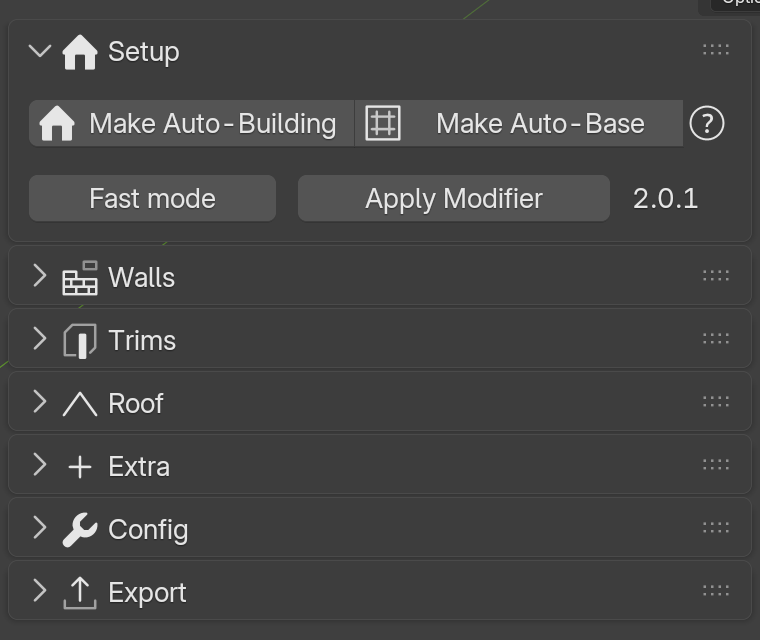
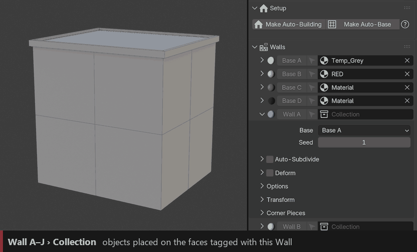
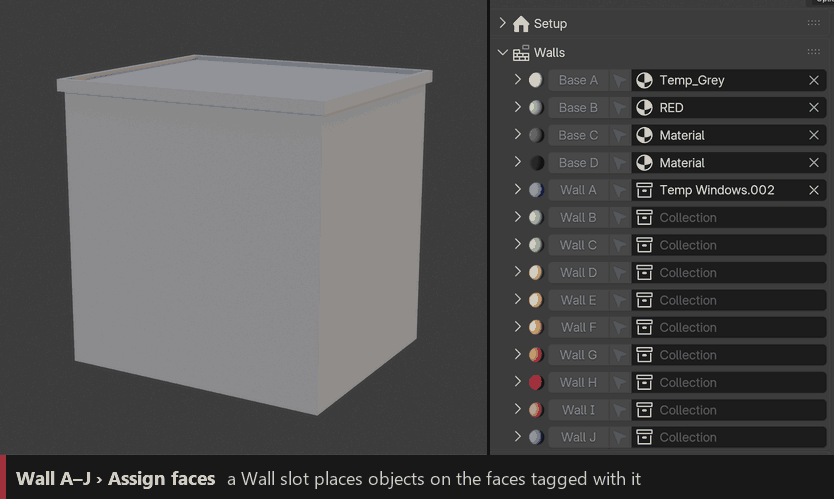
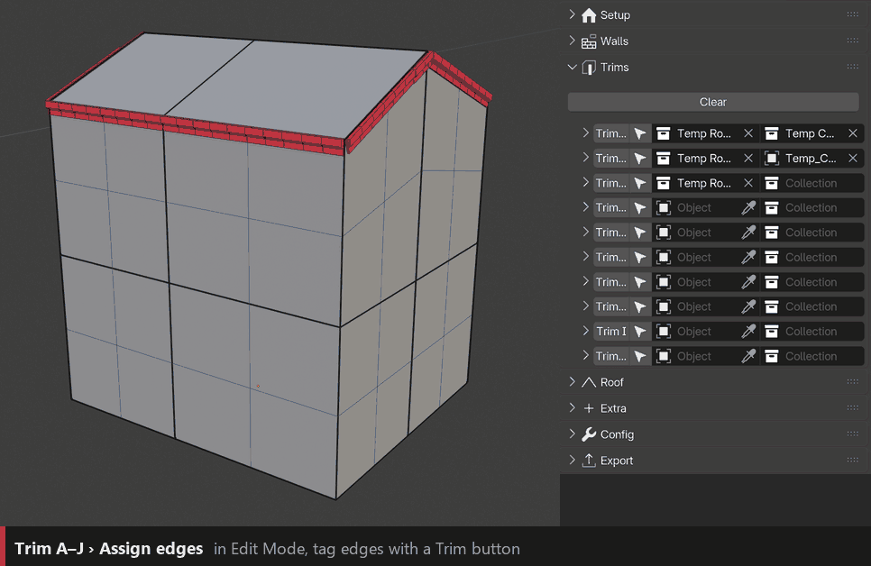
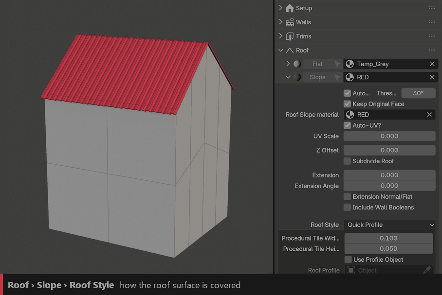

Quick Start
===========

From a cube to a building in a few minutes. You need the add-on installed (see :doc:`installation`) and a few part models; any window and door will do to start.

1. Create the building
----------------------

In the **Auto-Building** tab (``N`` panel), with nothing selected, click **Setup › Make Auto-Building**. A cube appears with the modifier and all the ID material slots ready.

Already have a blockout? Select it and click the same button.

2. Shape it
-----------

Enter **Edit Mode** and model the rough volume: extrude floors, add wings, cut the faces where you want windows and doors. Keep it low-poly: **one face = one slot** for a window or a door, and Auto-Subdivide can split large faces for you.

3. Prepare the parts
--------------------

Put each kind of part in its own collection: ``Windows``, ``Doors``… Model them with the **front facing +Z** and the **top facing +Y** (see :doc:`Buildingparts`).

4. Dress the walls
------------------

Open the **Walls** panel and pick your collections in the **Wall A**, **Wall B**… fields.

In Edit Mode, select faces and click **Wall A**: the windows appear. Click **Base A**–**D** on the plain faces to choose their wall style.

5. Add trims
------------

Select edges (``Alt+click`` for a loop) and click a **Trim** button to run a ledge, a cornice or a beam along them. Pick the trim collection in the same row.

6. Roof and details
-------------------

Roofs appear by themselves on the top faces: pick a **Roof Tile** collection in the **Roof** panel. Then explore **Extra**: foundation, supports, facade props, pipes, interiors, destruction…

7. Keep going
-------------

- Edit the base mesh at any time: the building follows.
- Turn on **Fast mode** while you model a heavy building.
- When it is done, see :doc:`baking` and :doc:`game-engine`.

.. tip::
   Want a whole street fast? Try :doc:`autobase`: it builds the base mesh for you from a single face.
