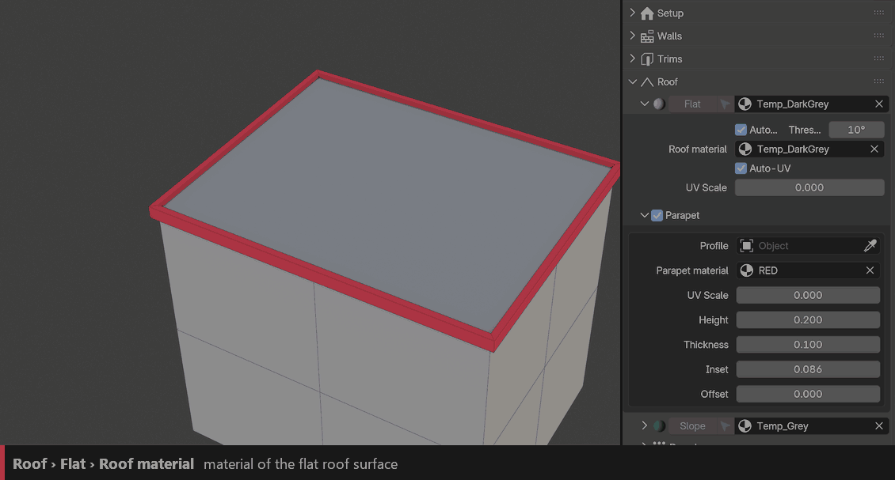
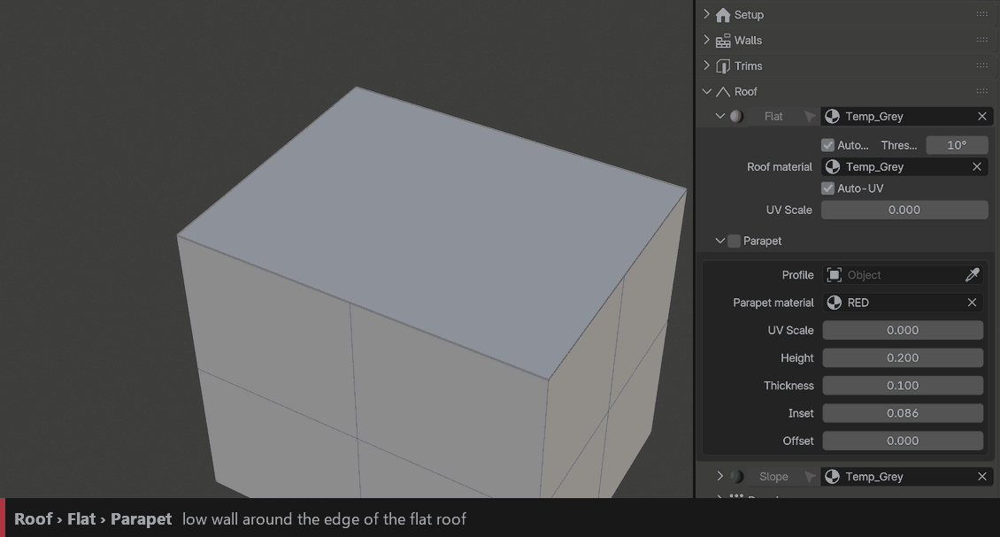
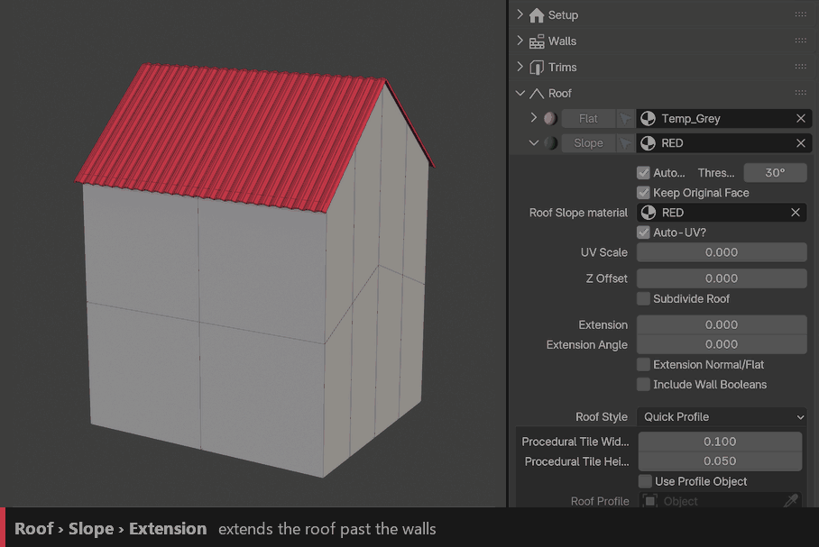
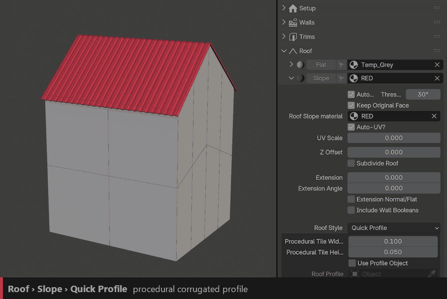
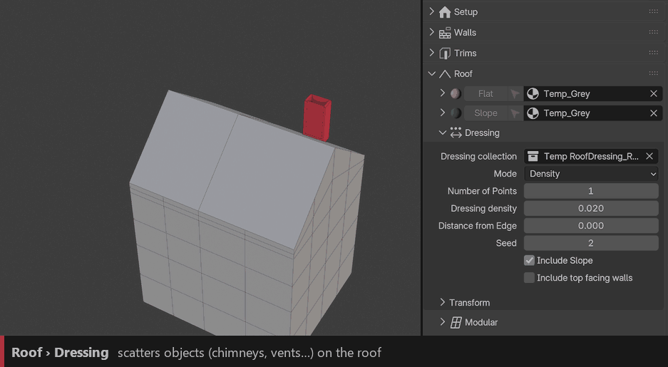
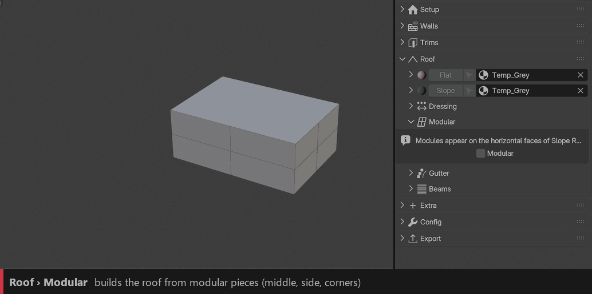
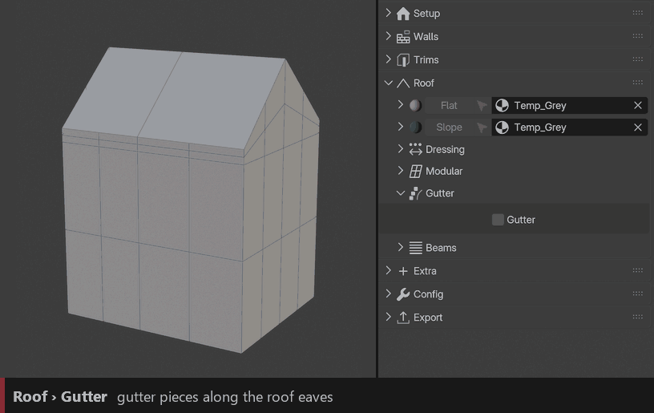
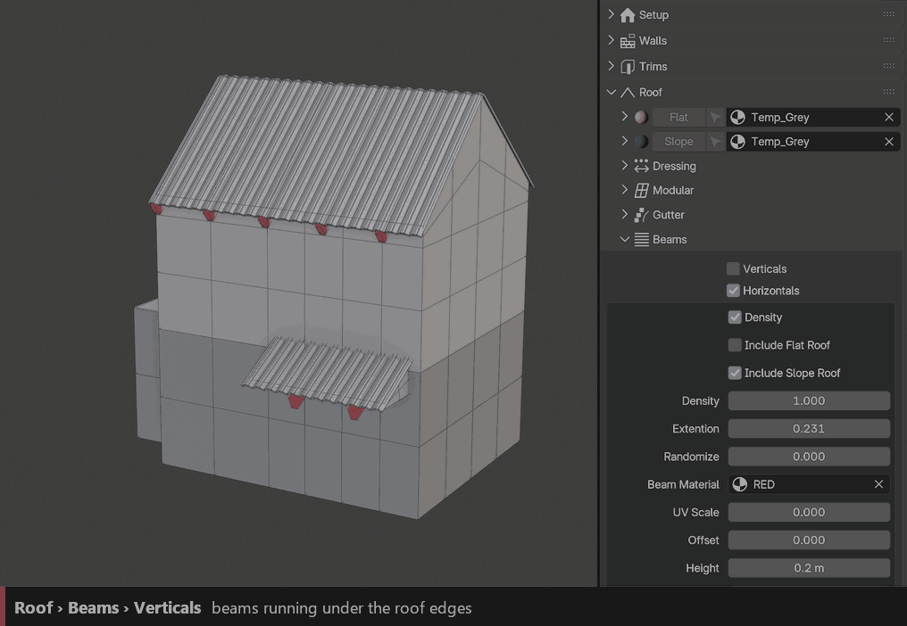

Roofs
=====

Roofs appear automatically on the top faces of the building: flat faces become **Flat** roofs, slanted faces become **Slope** roofs. You can force the type on any face with the **Flat** and **Slope** buttons (they assign ``ID_RoofFlat`` / ``ID_RoofSlope``).

Flat
----

``Material``
  Material of the flat roof surface, next to the **Flat** button.

``Auto-Flat Roof`` / ``Height``
  Detects flat roofs automatically, and moves the roof surface up or down.

``Auto-UV`` / ``UV Scale``
  Automatic UVs on the roof and their size.

Parapet
~~~~~~~

A low wall around the flat roof.

``Height`` / ``Thickness``
  Size of the parapet.

``Inset`` / ``Offset``
  Moves it inward or outward from the roof border.

``Profile``
  Optional curve used as the parapet profile.

``Material`` / ``UV Scale``
  Material and UV size of the parapet.

Slope
-----

``Material`` / ``Auto-UV`` / ``UV Scale``
  Material of the roof surface under the tiles.

``Auto-Slope`` / ``Threshold``
  Detects slope roofs automatically, from this angle.

``Keep Original Face``
  Keeps the roof surface under the tiles.

``Extension`` / ``Extension Angle`` / ``Extension Normal/Flat``
  Extends the roof past the walls (eaves), with its angle and direction.

``Z Offset`` / ``Subdivide Roof`` / ``Include Wall Booleans``
  Raises the roof, adds resolution, and lets wall boolean shapes cut it.

Roof Style
~~~~~~~~~~

How the tiles are laid on the slope.

.. image:: images/features/roof_slope_style.gif
   :class: feature-gif
   :alt: Roof styles

``Roof Style``
  **Quick Profile**, **Quick Distribution**, **Random**, **UV (Auto)**, **UV (Manual)**, **Slices**, **Subdivision** or **Precise**. The two *Quick* styles are the fastest; the others give more control on irregular roofs.

``Roof Tile``
  Collection of tile objects.

``Randomize`` / ``Seed`` / ``Amount``
  Random tile choice, and Amount below 100% removes some tiles.

``Density``
  Number of tiles across and along the slope.

``Ignore Incline`` / ``Stagger Rows`` / ``Stretch Tiles``
  Keeps tiles level, offsets every other row, or stretches tiles to fill gaps.

``Random Translation`` / ``Random Rotation`` / ``Random Scale`` / ``Random Flip X/Y/Z``
  Random variation per tile, for an older, irregular look.

Quick Profile
~~~~~~~~~~~~~

Builds the roof covering from a profile instead of individual tiles. Very light, ideal for background buildings.

``Roof Profile`` / ``Thickness`` / ``Tile Width`` / ``Tile Height``
  Optional custom profile, or the size of the procedural one.

Mask
~~~~

Removes or varies tiles with a pattern (**Noise**, **Y Wave**, **Checker** or an **Image**), for damaged or patched roofs.

Procedural Top-Edge
~~~~~~~~~~~~~~~~~~~

A ridge cap generated along the top edge of the slope: material, radius, thickness, height and extension past the ends.

Dressing
--------

Scatters objects on the roof: chimneys, vents, antennas, AC units…

``Collection`` / ``Mode``
  Objects to scatter, by **Number of Points** or by **Density**.

``Distance From Edges`` / ``Seed``
  Keeps objects away from the roof borders, and changes the layout.

``Include Slope`` / ``Include Top Facing Walls``
  Also scatters on slope roofs and on other top-facing faces.

``Random Translate / Rotation / Scale``
  Random variation per object, each with its own seed.

Modular
-------

Builds the roof from blocks, like Lego: middle, side, outer corner and inner corner pieces. All blocks must share the same cube size. Check the example objects to see how they are built.

``Middle`` / ``Side`` / ``Corner Out`` / ``Corner In``
  The four block objects.

``Cell Size`` / ``Scale`` / ``Offset Z``
  Size of one block, overall scale and height.

Gutter
------

Gutters along the eaves, with optional downspouts down the walls.

``Collection`` / ``Spacing`` / ``Fit`` / ``Deform``
  Gutter pieces and how they are laid along the eaves.

``Trim`` / ``Z Offset`` / ``Distance``
  Shortens the gutter at both ends, moves it up or down, and extends it past the corners.

``Downspouts``
  Pipes from the gutter down to the ground. Unfold it to set radius, elbow radius, wall gap, spacing, brackets and material.

Beams
-----

Wooden beams under the roof.

``Horizontal``
  Rafters running from the eaves up to the ridge.

``Vertical``
  Purlins running level along the roof (slope roofs only).

``Include Flat Roof`` / ``Include Slope Roof``
  Which roofs get beams.

``Density`` / ``Extension`` / ``Random Extension``
  Number of beams and how far they stick out past the roof.

``Width`` / ``Height`` / ``Offset`` / ``Translate Z`` / ``Material`` / ``UV Scale``
  Size, position and material of the beams.
