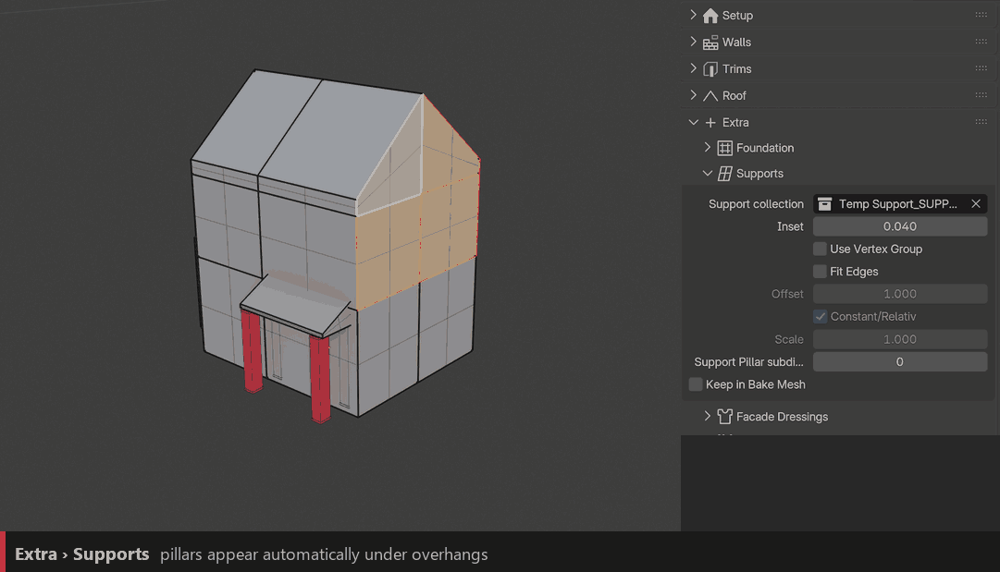
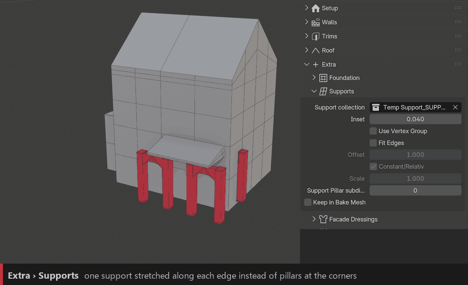

Supports
========

Pillars appear **automatically** under every part of the building that overhangs: extrude an upper floor out and the pillars follow.

``Support Collection``
  Objects used as pillars.

``Inset``
  Moves the pillars in from the corners.

``Support Pillar Subdivision``
  Adds more pillars along the edges.

``Use Vertex Group`` / ``Vertex Group Name``
  On: pillars only on the vertices of this vertex group (``Supports`` by default). Off: a pillar on every corner of the overhang.

``Keep in Bake Mesh``
  Includes the supports when baking the building to a mesh (see :doc:`baking`).

Fit Edges
---------

Instead of a pillar at each corner, the object spawns on the **edges in between** and is scaled to fit them. Use it for arches, beams or panels under a porch or balcony.

``Fit Edges``
  Turns the fitted mode on.

``Offset``
  Lower values push the fitted support outward.

``Constant/Relative`` / ``Scale``
  Size of the fitted support, fixed or relative to the edge.
