Trims
=====

Trims decorate the **edges** of the building: ledges, cornices, sills, beams, corner stones… anything that runs along an edge.

There are **ten Trim channels, A to J**. Each channel has a **Horizontal** and a **Vertical** part, detected automatically, so the horizontal Trim A can be completely different from the vertical Trim A.

Assigning edges
---------------

In **Edit Mode**, select the edges (``Alt+click`` selects a whole edge loop) and click a **Trim** button: the trim appears on them. The **Clear** button removes it.

.. image:: images/features/trims_assign.gif
   :class: feature-gif
   :alt: Assigning Trim A to edges

.. tip::
   The horizontal/vertical detection angle is in :doc:`config`.

   *Bonus:* each channel is a range of crease values, shown at the top of its panel. The Trim buttons set it for you; you only need this to set it by hand (``Shift+E``).
   A 0–0.1 · B 0.1–0.2 · C 0.2–0.3 · D 0.3–0.4 · E 0.4–0.5 · F 0.5–0.6 · G 0.6–0.7 · H 0.7–0.8 · I 0.8–0.9 · J 0.9–1.0

Horizontal
----------

``Mode``
  How the trim is built along the edge:

  - **Array Spacing** – objects repeated along the edge with a spacing.
  - **Array Stacked** – objects placed one after the other; Spacing becomes the gap between them.
  - **Array Deformed** – objects bent to follow the edge.
  - **Edge Center** – one object in the middle of each edge.
  - **Curve Extrude** – a profile shape swept along the edge. Uses a **Profile Object** instead of a collection (see below).

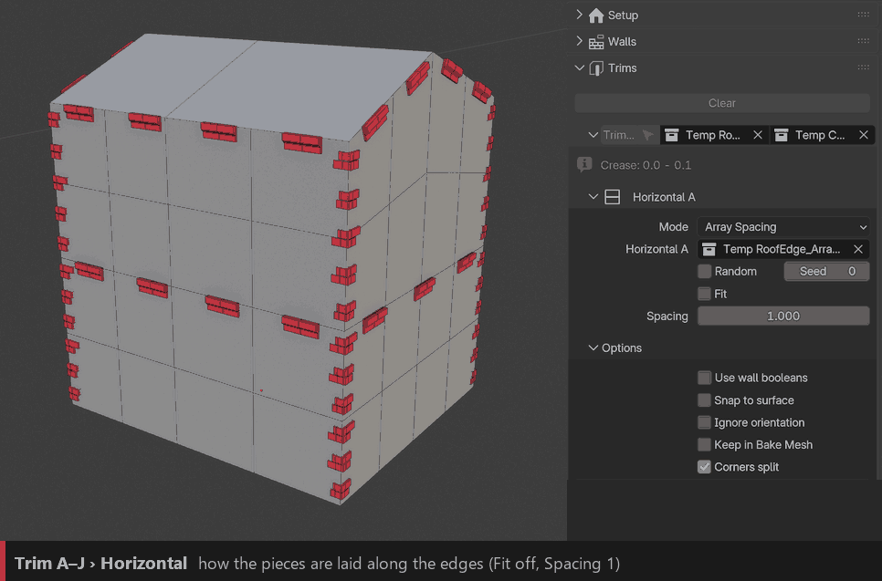

Curve Extrude
~~~~~~~~~~~~~

In this mode the field next to **Horizontal / Vertical** no longer takes a collection: it takes a **Profile Object**, a flat curve or mesh whose outline is swept along every edge of the channel. Perfect for continuous cornices, ledges and moldings.

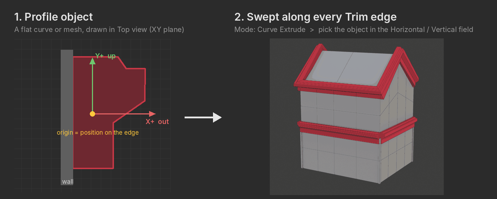

- Draw the profile **flat in Top view** (XY plane): **Y+** is up, **X+** points away from the wall.
- The **origin** of the object is the point that sits on the edge.
- No profile at hand? Tick **Procedural Profile** to use a simple box shape, sized with Width and Height.

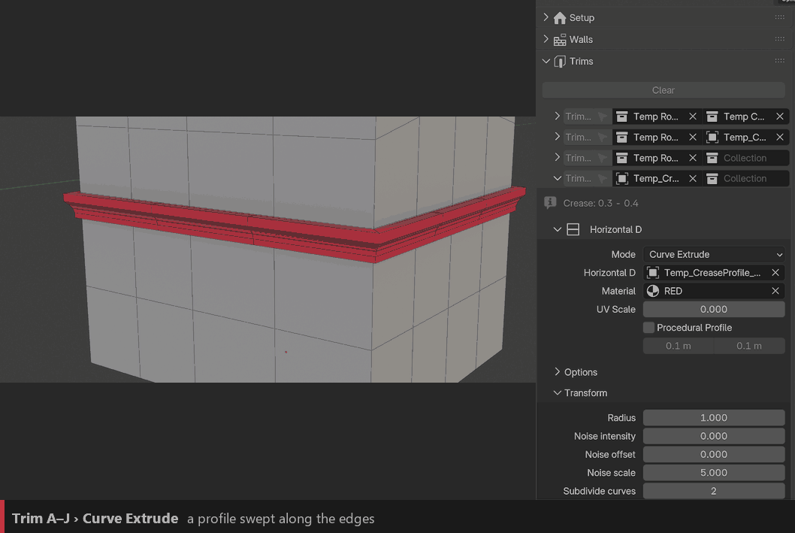

``Procedural Profile`` / ``Width`` / ``Height``
  A simple box profile instead of the Profile Object, sized with Width and Height.

``Radius``
  Scales the profile.

.. tip::
   In Curve Extrude mode, the **Transform** panel only shows Radius, Noise and Subdivide Curves.

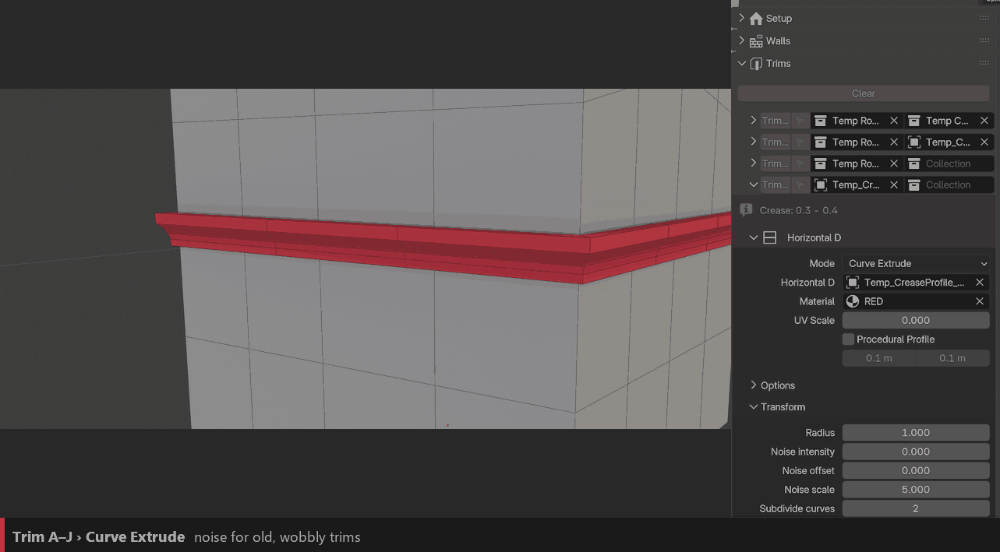

``Noise Intensity`` / ``Noise Scale`` / ``Noise Offset``
  Wobbles the trim for old or hand-made buildings: strength, size of the waves, and another variation.

``Subdivide Curves``
  Adds points along the curve. The noise needs them: with a low value it is hardly visible.

Collection modes
~~~~~~~~~~~~~~~~

``Collection``
  Objects placed along the edges (all modes except Curve Extrude).

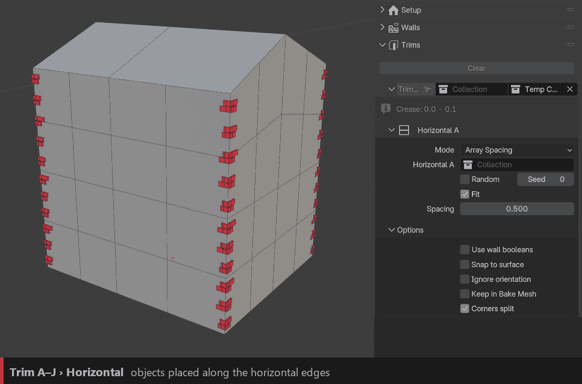

``Random`` / ``Seed``
  Picks objects from the collection at random instead of in order (shown in the Vertical GIF below).

``Fit`` / ``Spacing``
  Fit scales the pieces so they fill the edge without gaps. Spacing sets the distance between pieces.

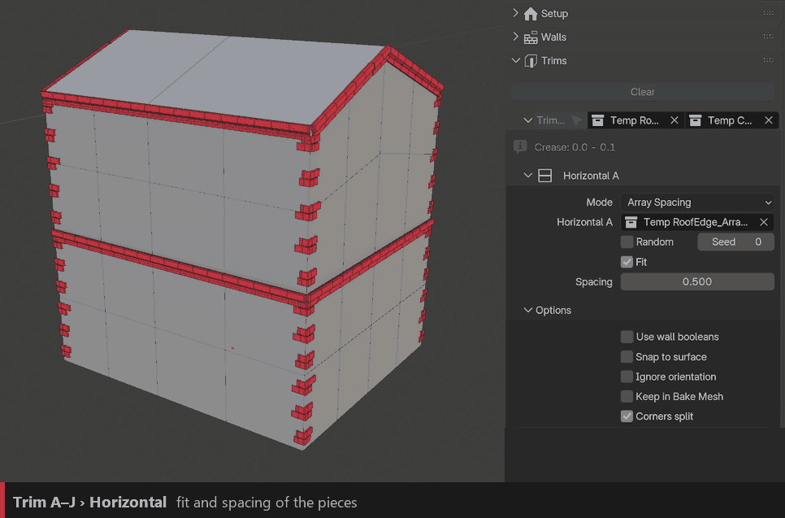

Options
~~~~~~~

``Use Wall Booleans``
  The ``ID_Boolean`` shapes of the wall objects also cut the trims, so a ledge never crosses a window.

``Snap to Surface``
  For "floating" edges that don't belong to a face (loose edges): the trim is snapped onto the nearest face.

``Ignore Orientation``
  Keeps the pieces upright instead of following the face they sit on.

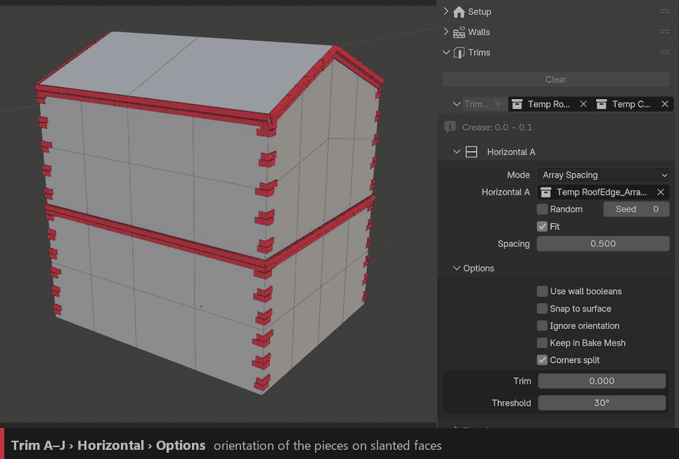

``Corners Split`` / ``Trim`` / ``Threshold``
  On: the trim is cut at each corner, and **Trim** shortens it there. Off: the trim runs around the corner (in Array Spacing / Stacked, with a mitred corner piece). **Threshold** is the angle that counts as a corner.

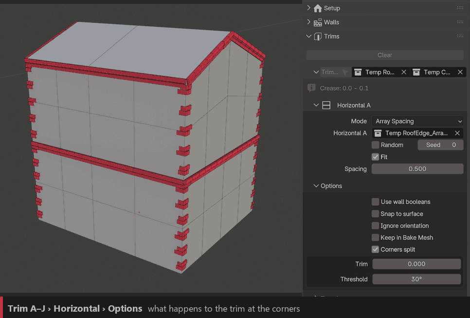

``Keep in Bake Mesh``
  Includes the trim when baking the building to a mesh (see :doc:`baking`).

Transform
~~~~~~~~~

``Translate`` / ``Rotation`` / ``Scale``
  Moves, rotates and scales every piece.

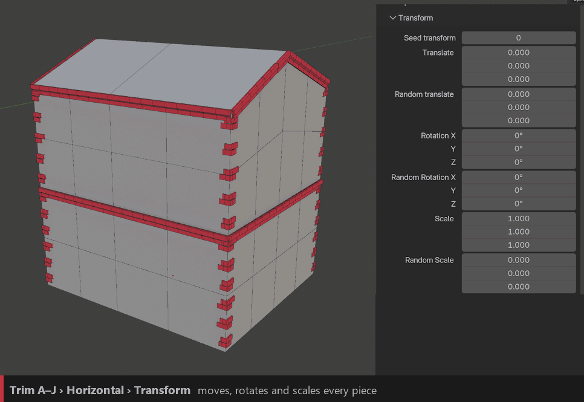

``Random Translate`` / ``Random Rotation`` / ``Random Scale`` / ``Seed Transform``
  Adds random variation per piece. Great for old buildings.

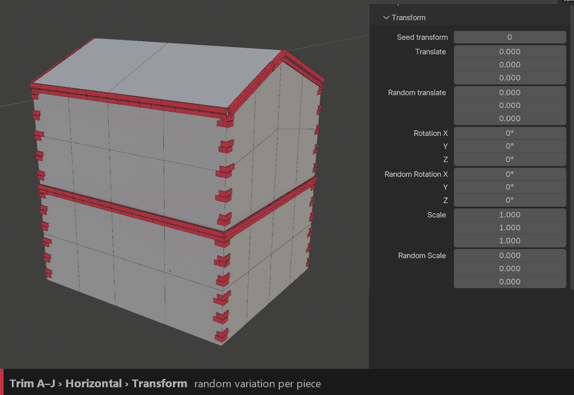

Corner Pieces
~~~~~~~~~~~~~

A dedicated object on the corners, on top of the trim.

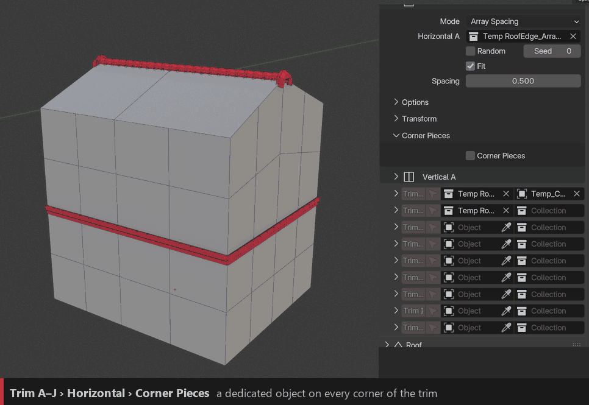

``Collection``
  The corner object(s).

``Corner Angle`` / ``Corner Angle Threshold``
  Only corners close to this angle get a piece; the threshold sets how far from it still counts.

``Translation``
  Moves the corner pieces.

``Rotate By`` / ``Ignore Rotation``
  Extra rotation of every corner piece. With Ignore Rotation on, all pieces keep the same orientation; off, they turn with each corner.

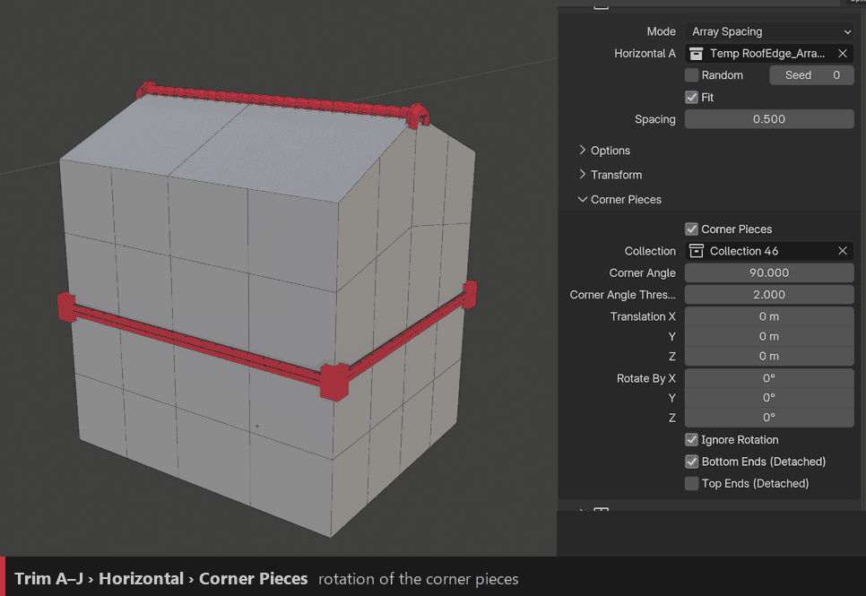

``Bottom Ends`` / ``Top Ends``
  Also places pieces on the free ends of detached edges.

Vertical
--------

The vertical part has the same settings as the horizontal one (collection, random, spacing, fit…), plus two of its own:

``Trim Start`` / ``Trim End``
  Shortens the vertical edges at the bottom or at the top.

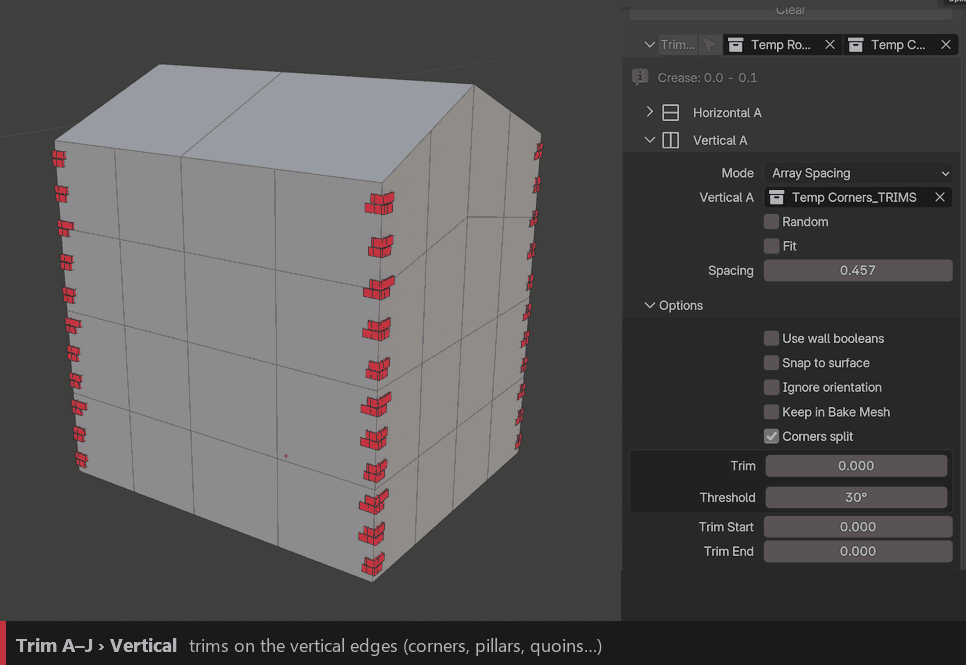
