Walls
=====

Walls are driven by **ID materials**. Select faces on your base mesh, click a button in the **Walls** panel, and the matching ID material is assigned to them. You can also assign the materials by hand through the material slots.

There are two kinds of wall:

- **Base A–D** – the plain surface of the building (plaster, bricks, wood…).
- **Wall A–J** – objects spawned on the faces (windows, doors, balconies…), with a Base behind them.

.. tip::
   Each letter row has an **assign button** (the greyed letter on the left) and a **material or collection field** on the right. Click the small arrow to unfold its settings.

Base A–D
--------

Up to four base wall styles. Each one has the same settings.

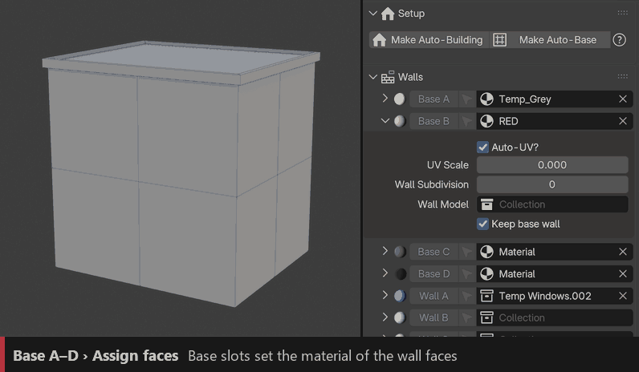

``Assign``
  In Edit Mode, select faces and click **Base A** to **Base D** to give them that style (assigns ``ID_BaseA`` to ``ID_BaseD``).

``Material``
  Material of the base wall, in the field next to the button.

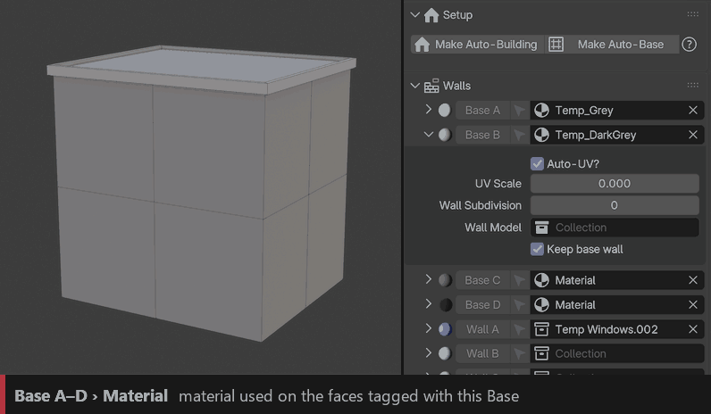

``Auto-UV`` / ``UV Scale``
  Generates UVs on the wall automatically. UV Scale sets the texture size.

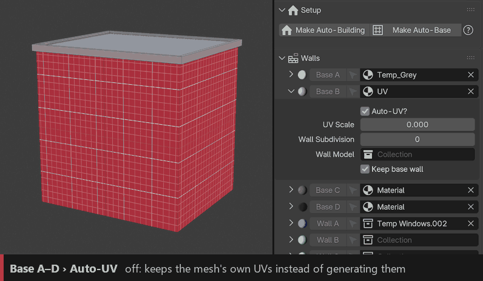

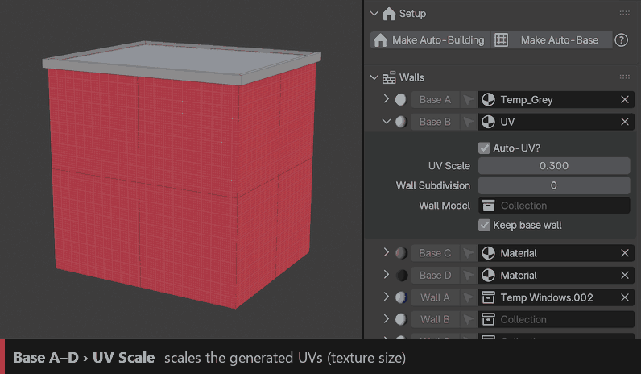

``Wall Subdivision``
  Cuts the wall faces into smaller faces. Useful for deformation and destruction.

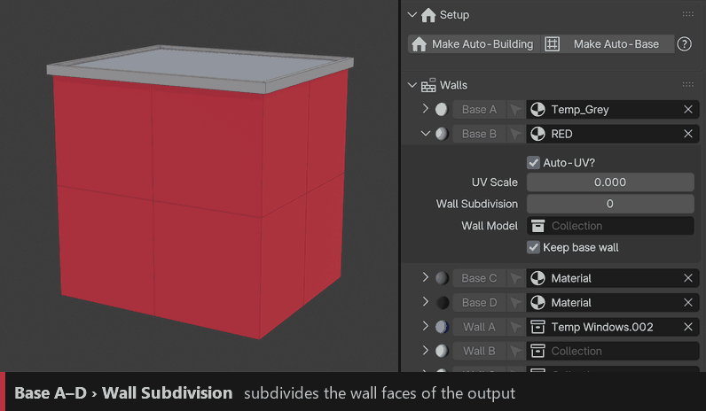

``Wall Model``
  Optional collection of wall panels (bricks, planks, stones…) instanced on the surface instead of a plain material.

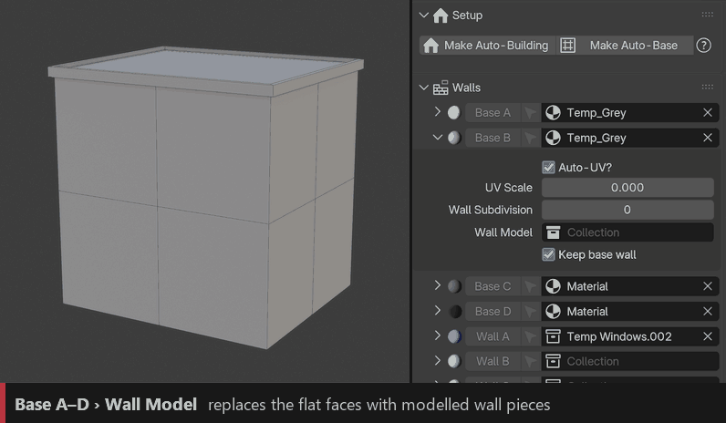

``Keep Base Wall``
  Keeps the original flat wall under the Wall Model pieces.

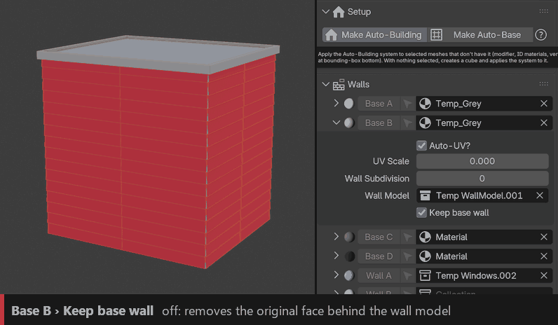

Wall A–J
--------

Up to ten collections of objects (windows, doors, shop fronts…). All letters share the same settings.

.. image:: images/features/walls_wall_assign.gif
   :class: feature-gif
   :alt: Assigning Wall A to faces

``Assign``
  Select faces and click **Wall A** to **Wall J** (assigns ``ID_WallA`` to ``ID_WallJ``). One object is placed on each face.

``Collection``
  Collection of objects spawned on the faces. If it holds several objects, one is picked at random per face.

.. image:: images/features/walls_wall_collection.gif
   :class: feature-gif
   :alt: Wall collection

.. tip::
   **Cutting holes:** give a part of your window or door model the ``ID_Boolean`` material and it cuts a hole in the wall. Use **Setup › Assign Boolean Faces** in Edit Mode on your part. See :ref:`Building parts › Booleans <part-booleans>`.

``Base``
  Which Base (A–D) fills the wall around and behind the objects.

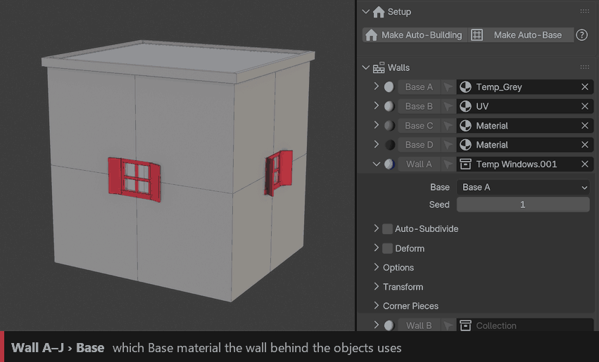

``Seed``
  Picks another random object per face.

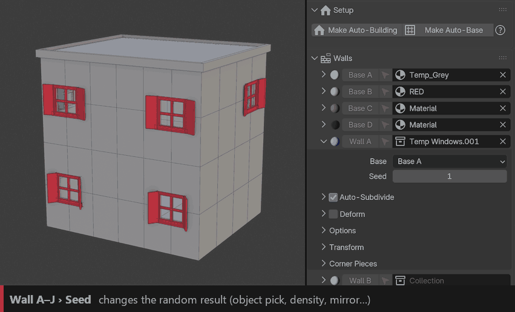

Auto-Subdivide
~~~~~~~~~~~~~~

Splits large faces into a grid so several objects fit on one face.

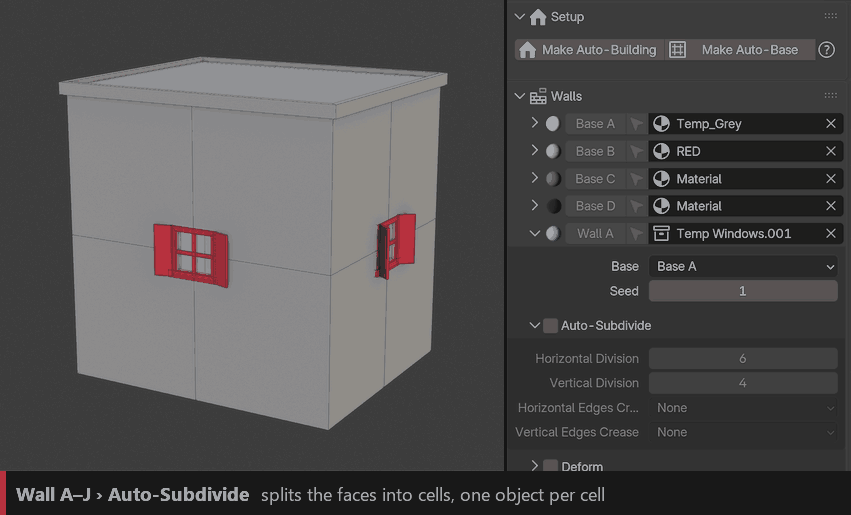

``Horizontal Division`` / ``Vertical Division``
  Target size of the cells in each direction.

``Horizontal / Vertical Edges Crease``
  Gives the new edges a crease, so a Trim can follow them (see :doc:`trims`).

Deform
~~~~~~

Bends each object to the exact shape of its face (great for slanted or irregular faces).

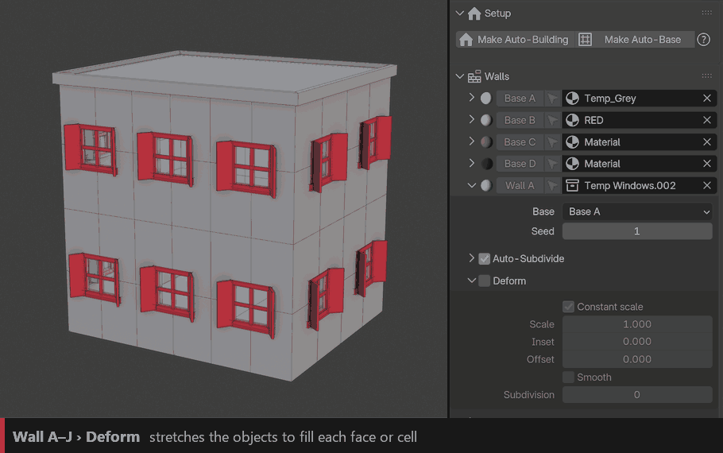

``Constant Scale`` / ``Scale``
  Keeps the object depth constant instead of scaling it with the face.

``Inset``
  Shrinks the face before deforming, leaving a border of wall around the object.

``Smooth`` / ``Subdivision``
  Adds resolution so the object follows the face more smoothly.

Options
~~~~~~~

``Density``
  Lower it to randomly remove objects.

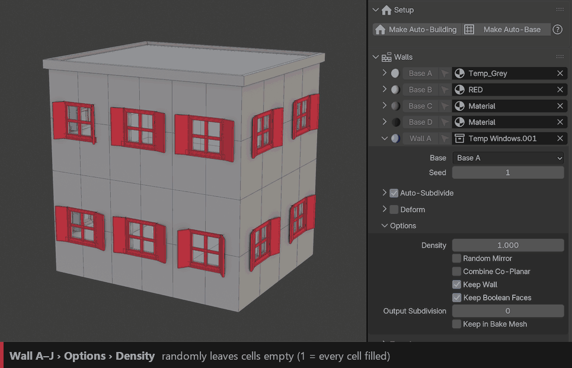

``Random Mirror``
  Randomly mirrors objects for variation.

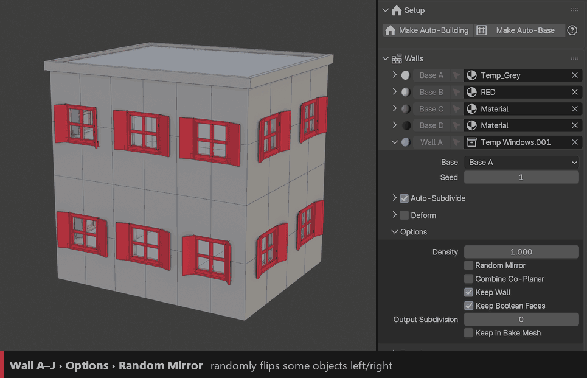

``Combine Co-Planar``
  Merges neighbouring faces that lie on the same plane, so they get one object instead of one per face.

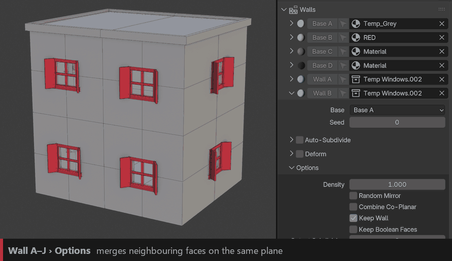

``Keep Wall``
  Keeps the base wall face behind the object.

``Keep Boolean Faces``
  Lines the holes cut by the ``ID_Boolean`` shapes with a thin wall (a reveal), so openings look thick.

``Output Subdivision``
  Subdivides the remaining wall so it can bend with Deformation or Destruction.

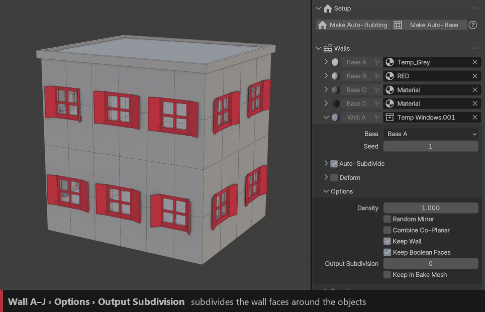

``Keep in Bake Mesh``
  Includes these objects when you bake the building to a mesh (see :doc:`baking`).

Transform
~~~~~~~~~

``Snapping``
  Where the object sits on its face: **Center**, **Bottom** or **Top**.

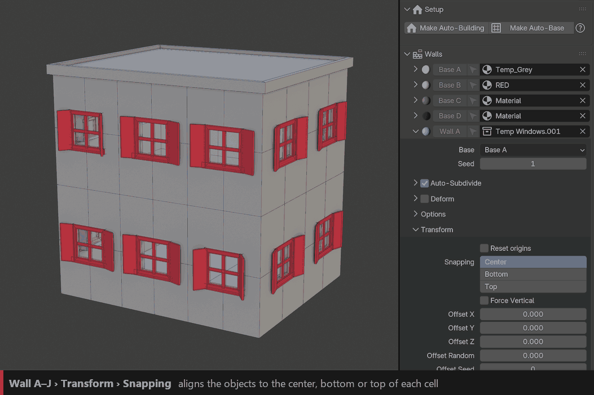

With **Bottom**, a door stays on the ground even when the wall gets taller, while a centred window moves up with the middle of the face.

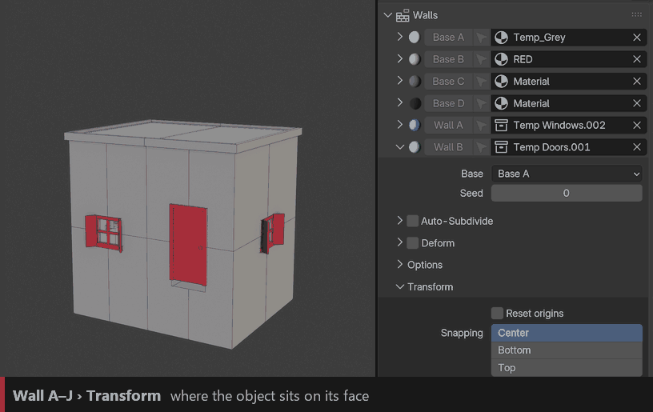

``Offset X / Y / Z`` / ``Offset Random`` / ``Offset Seed``
  Moves the objects on each axis (Y pushes them in or out of the wall), with an optional random amount.

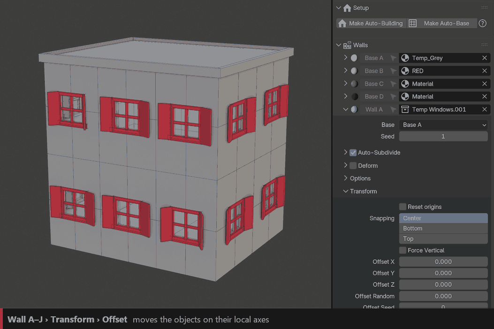

``Reset Origins``
  Ignores the object's own origin when placing it.

``Force Vertical``
  Keeps objects upright on slanted walls instead of leaning with the face.

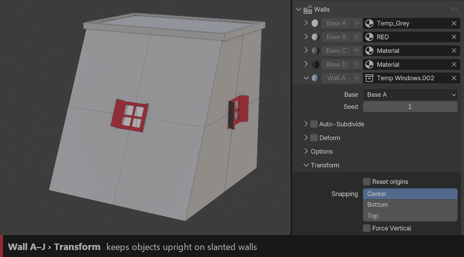

Corner Pieces
~~~~~~~~~~~~~

Places a dedicated object on the wall corners, for example corner stones or quoins.

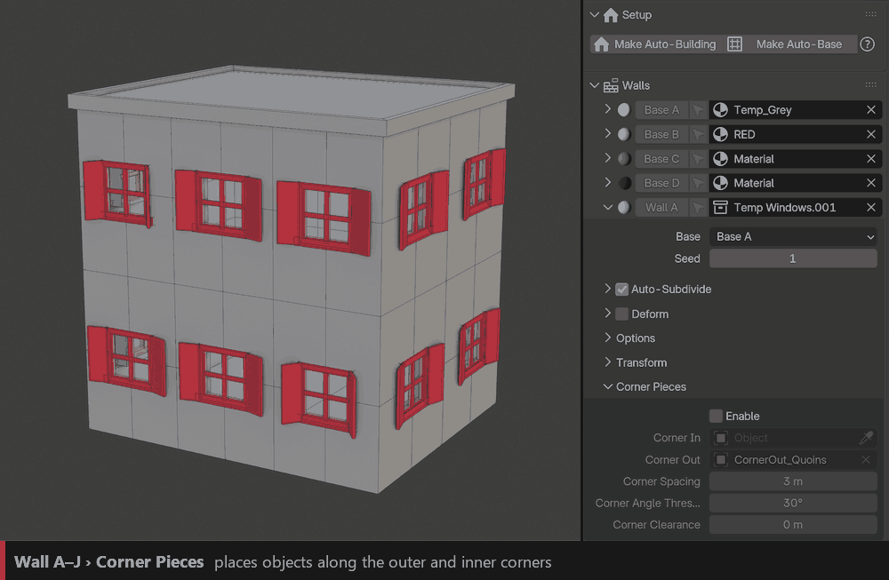

``Corner In`` / ``Corner Out``
  Objects used on inner and outer corners.

``Corner Spacing`` / ``Corner Angle Threshold`` / ``Corner Clearance``
  The piece repeats up the corner every Corner Spacing and is scaled to fill the height exactly. Also sets which angles count as a corner and the gap kept free around it.

Modular kits
^^^^^^^^^^^^

Corner Pieces also work with a **modular kit**, the way game-engine assets are built: wall panels (window, door…) as Wall A/B/C, and a dedicated corner panel as ``Corner Out``. The walls snap to the module size and the corner panel closes every outer corner cleanly.

.. image:: images/wall_corner_kit_pieces.png
   :alt: Modular kit pieces: window panel, door panel and corner panel

Model all pieces on the same module size, then turn on **Module Grid** (see :doc:`deformation`) so the building always lands on whole modules.
